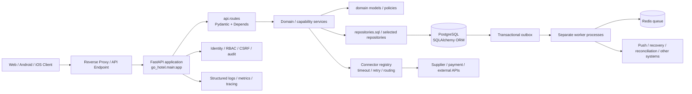

# GO 后端架构与代码实现说明

> 范围：以当前仓库 `application/src/go_hotel/` 的 Python 后端为主，结合移动端登录调用链、数据库模型、后台 worker 和当前部署定义说明。本文描述代码结构，不代表这些代码已经部署到某个运行环境或该环境目前可访问。

## 1. 先看结论

GO 后端当前采用 **FastAPI 模块化单体**：一个主要 API 应用集中注册大量路由模块，业务按领域和能力拆分为 Python package/service；持久化主要通过 SQLAlchemy 写入 PostgreSQL，Redis 用于队列/异步消息，若干 worker 作为独立进程运行。它不是微服务集合，也不是只有一个登录服务。

手机登录所需的后端实现已经在源码中：

- `POST /v1/mobile/auth/login` 定义在 `application/src/go_hotel/api/routes/mobile.py`。
- 登录业务在 `application/src/go_hotel/consumer/service.py`，底层身份验证、会话和 token 由 `application/src/go_hotel/security/service.py` 负责。
- 消费者注册另有 `POST /v1/consumer/auth/register`，定义在 `application/src/go_hotel/api/routes/consumer_identity.py`。

目前真机登录失败，不能据此判断后端代码缺失。源码里至少有两个直接可见的前置问题：

1. 移动端默认 API 地址是 `http://localhost:8000`。在实体手机上，`localhost` 指手机自身；如果没有为 API 端口配置 USB reverse，手机不会连到开发电脑上的后端。
2. 后端启动时只创建管理端和供应商 bootstrap 用户，不创建消费者账号。登录需要一个已注册的消费者账号；而当前移动端“创建 GO ID”按钮只显示提示，不会调用注册接口。

此外，仓库源码存在路由层直接调 service/数据库、全局入口过大、消费者注册跨多个事务等结构问题。具体影响见第 10 节。

## 2. 高层结构



图中是代码职责关系，不代表每个方框都是独立部署的微服务。当前 API 主体部署为一个应用进程；worker 复用同一 Python 包和镜像，以不同 module entrypoint 单独运行。PostgreSQL、Redis 及入口代理由部署环境提供。

## 3. 目录和模块地图

| 路径 | 主要职责 | 代码入口/代表模块 |
|---|---|---|
| `application/src/go_hotel/main.py` | FastAPI 组合入口、router 汇总、middleware、lifespan | `app = FastAPI(...)` |
| `application/src/go_hotel/api/routes/` | HTTP 路由、请求/响应边界、参数校验、身份依赖 | `mobile.py`、`consumer_identity.py`、`hotel.py`、`booking.py` |
| `application/src/go_hotel/api/` | API schema、幂等调用及共享协议 | `schemas.py`、`idempotency.py` |
| `application/src/go_hotel/security/` | 身份验证、Principal、RBAC、JWT/密码、MFA、Cookie/CSRF | `service.py`、`deps.py`、`crypto.py`、`rbac.py` |
| `application/src/go_hotel/consumer/` | 消费者账户、profile、旅客、钱包等应用服务 | `service.py` |
| `application/src/go_hotel/mobile/` | 设备、推送、移动端 engagement | `service.py`、`push.py`、`orchestration.py` |
| `application/src/go_hotel/domain/` | 部分核心领域对象、状态机、事件和 ID 辅助函数 | `models.py` |
| `application/src/go_hotel/services/` | 酒店交易、支付、退款、生命周期、供应商及能力服务 | `booking.py`、`outbox.py` 等 |
| `application/src/go_hotel/repositories/` | 面向领域的持久化封装和内存/SQL repository | `sql.py`、`memory.py` |
| `application/src/go_hotel/db/` | SQLAlchemy Base、集中式 ORM 模型、Engine/Session | `models.py`、`session.py` |
| `application/src/go_hotel/connectors/` | 外部供应商 adapter、registry、mapping 和 resilience | `base.py`、`registry.py`、`resilience.py` |
| `application/src/go_hotel/routing/`、`merge/` | 流量选择、候选供应和报价归并 | `router.py`、`merge/engine.py` |
| `application/src/go_hotel/queue/` | Redis 与耐久队列实现 | `redis_queue.py`、`durable_regional.py` |
| `application/src/go_hotel/workers/` | 可单独运行的长任务、outbox、对账、移动推送 worker | `python -m go_hotel.workers.<module>` |
| `application/src/go_hotel/observability/` | 日志、指标、SLO 和健康观测 | `logging.py`、`metrics.py`、`slo.py` |
| `application/alembic/` | 数据库 schema 的版本化迁移 | `env.py`、`versions/` |
| `application/tests/` | API、服务、数据库和跨模块验收 | pytest 测试文件 |

截至当前代码，`api/routes` 下约有 110 个路由模块，`services` 下约有 100 个文件，Alembic 下约有 135 个迁移文件。这说明能力覆盖面已经很宽，阅读时应沿具体业务入口追踪调用链，不要把文件数量误解成相同数量的独立服务。

## 4. API 进程的启动与请求生命周期

### 4.1 进程启动

1. 容器或本地命令以 `uvicorn go_hotel.main:app` 加载全局 `app`。
2. `main.py` 导入各 API router，并集中调用 `app.include_router(...)`；Agent Gateway 通过 `install_agent_gateway(app)` 安装自己的协议入口。
3. FastAPI lifespan 调用 `identity_service.bootstrap()`，确保管理端和供应商 bootstrap identity 存在；按 `Settings` 开关启动少量 API 进程内的 expiry coroutine。
4. `application/Dockerfile` 使用 Python 3.12、安装 `application/pyproject.toml` 声明的依赖，并以 Uvicorn 提供 8000 端口。
5. 数据结构由 Alembic 迁移维护。当前 HK-STAGING 业务 runtime Compose 将 API 与 worker 分开定义，数据库和 Redis 属于环境侧服务。

lifespan 在 API 启动时访问数据库。因此即使某个 HTTP 路由文件存在，API 进程仍可能因数据库连接、迁移版本或必需配置问题而无法提供服务。

### 4.2 单次 HTTP 请求

典型处理顺序：

```text
HTTP request
  -> main.py middleware（request id、审计/安全/观测）
  -> FastAPI APIRouter 路由匹配
  -> Pydantic body/path/header 校验
  -> Depends 注入 Principal 或其他依赖
  -> route 调用一个或多个 service
  -> service 读取/变更领域对象并访问 SQLAlchemy Session / repository
  -> 数据库 commit 或发布 outbox 记录
  -> JSON response（业务响应通常包在 data 中）
```

`security/deps.py` 的 `current_principal` 从 Bearer header 或允许的 Cookie 取得 access token，交给 `identity_service.authenticate()` 校验；它还会检查 session 是否撤销、用户是否有效及 actor context。`consumer_principal`、`supplier_account_principal`、`admin_principal` 在此基础上限制主体类型。数据归属还需要业务 route/service 显式检查，例如 `assert_consumer_order()` 将订单 account_id 与 Principal.user_id 比较。

### 4.3 Middleware 和健康检查

`main.py` 集中安装 request ID/审计、安全和 observability middleware。登录/注册路径位于 CSRF middleware 的免校验列表中；非安全 HTTP 方法的浏览器 Cookie 会话仍受 CSRF 规则约束，Bearer 客户端使用 Authorization header。

`GET /health` 在 `api/routes/health.py` 中只返回服务状态字符串，不检查数据库、Redis、迁移或 worker 状态，因此它适合作为轻量存活信号，不能单独证明“登录依赖全部健康”。另有需要管理员权限的 `/internal/v1/ops/readiness` 与 `/run`，在 `api/routes/observability.py` 中执行并可持久化 readiness gate；这属于受控运维检查，不是当前 `/health` 的依赖探针。

## 5. 业务模块如何实现

### 5.1 以酒店交易为例

`api/routes/hotel.py` 提供酒店搜索和 prebook HTTP 入口，`services/booking.py` 编排主要流程：

1. 搜索时调用 `routing.router.traffic_router` 获取候选供应，再用 `merge.engine.offer_merge_engine` 归并相同/近似报价。
2. 把 canonical offer 与事件写入 repository，并初始化 fare rule snapshot。
3. Prebook 重新检查报价过期、库存、价格、政策和权益；对账失败时返回具体业务冲突，而不是继续创建订单。
4. 创建订单前再次校验 prebook 状态及用户确认的规则 hash，将订单和事件一并持久化。
5. 支付、供应商确认、退款等走各自服务和 adapter；跨步骤的恢复/重试由 saga、outbox、reconciliation 和 recovery worker 协同。

领域入口不是只靠单一 `BookingService` 完成：例如 `consumer_identity.py` 的新订单入口还会验证 fare consent、释放旅客资料、调用 `booking_service`，并按需追加业务 evidence。这体现了能力组合式实现，也说明排查交易问题要看 route 中调用的所有服务，不能只读同名 service 文件。

### 5.2 外部供应商和支付集成

`connectors` 定义 adapter 能力和 registry；`services/booking.py` 通过 registry 选 adapter，并由 `ResilientConnector` 加入超时与有限重试。`routing` 负责候选路由，`merge` 负责合并报价，外部调用的错误会被转成领域错误或进入 recovery。仓库同时有 mock/sandbox 与 external connector 路径；读到一个 connector class 并不等于该供应商已经启用或真机交易已经验收。

### 5.3 Outbox 和异步任务

部分领域写入会在同一个 SQL transaction 中写业务变更及 outbox event。`services/outbox.py` 的 worker 使用 `FOR UPDATE SKIP LOCKED` 领取记录，发布后标记完成；失败时按退避时间重试，超过阈值进入 dead-letter 表。Redis 是可选 transport，不是唯一业务数据库。

这类设计降低了“数据库已提交但进程在发消息前崩溃”的丢事件风险，但消费端仍需幂等：worker 可能在发布成功、确认状态前崩溃，导致同一事件再次投递。API 中还有 `api/idempotency.py`，为部分交易写请求复用幂等键和结果。

### 5.4 Worker 部署方式

`workers/__main__.py` 刻意不启动一个隐式总 worker；每个进程选择具体 module，例如：

```text
python -m go_hotel.workers.outbox_worker
python -m go_hotel.workers.recovery_worker
python -m go_hotel.workers.reconciliation_worker
python -m go_hotel.workers.judgment_worker
python -m go_hotel.workers.mobile_engagement_worker
python -m go_hotel.workers.mobile_push_worker
python -m go_hotel.workers.mobile_push_receipt_worker
```

HK-STAGING 的 `deploy/hk-staging/docker-compose.business-runtime.yml` 明确列出一个 API 加七个业务 worker。API lifespan 里的 expiry coroutine 是另一种运行形态，要看配置开关；不要把“某个 worker 模块在源码中存在”推断为“运行环境当前已启动”。

## 6. 数据和持久化设计

- `db/session.py` 根据 `Settings.database_url` 建 SQLAlchemy Engine，并用 `SessionLocal` 创建 session；当前 schema 以 PostgreSQL 为主。
- `db/models.py` 集中定义大量 ORM Row，涵盖 identity、session、consumer profile、订单、报价、支付、供应商、outbox、mobile device 等表。
- `alembic/env.py` 把 `Base.metadata` 绑定到迁移环境；表结构的演进应走 Alembic，而不是让应用启动时临时自动建表。
- `repositories/sql.py` 和 `repositories/memory.py` 提供持久化抽象，`domain/models.py` 提供部分独立于 ORM 的对象/枚举。
- 实际边界还不完全严格：不少 route 和 service 直接导入 `SessionLocal`、ORM Row，repository abstraction 与直接 SQLAlchemy 使用并存。

## 7. 登录链路：从手机按钮追到数据库

### 7.1 客户端请求

登录页 `application/mobile/go-app/src/screens/LoginScreen.tsx` 收集邮箱和密码；`AuthContext.tsx` 调用 `src/api/client.ts` 导出的 transport。Transport：

1. 先清空已有本地 session，防止切换账号时混用 token。
2. 调用 `POST /v1/mobile/auth/login`，JSON body 为 `{ "email": "...", "password": "..." }`，不带旧 access token。
3. 检查返回 `data.access_token` 和 `data.refresh_token`，缺一会报 `INVALID_TOKEN_RESPONSE`。
4. 通过 `expo-secure-store` 写入 access/refresh token。
5. `AuthContext.reload()` 随后请求 `GET /v1/consumer/me`；这一步还会再次验证 access token 和消费者 profile。

`AuthContext.reload()` 会 catch `/me` 错误并清空 profile，不会把错误重新抛给 `LoginScreen`。所以登录接口可能已经返回 token，但随后的 profile 查询失败时，用户仍会停留在未认证 UI，且看不到原始 `/me` 错误。调试时要分别观察 login HTTP response 和紧随其后的 `/v1/consumer/me`。

Transport 默认请求超时 20 秒。未认证的 login 请求不会自动刷新 token；接口返回 401 时，界面会显示后端 detail，例如 `INVALID_CREDENTIALS` 或 `CONSUMER_IDENTITY_REQUIRED`。连接失败则更可能显示 `NETWORK_REQUEST_FAILED`，它和密码错误不是同一类故障。

### 7.2 后端登录处理

```text
POST /v1/mobile/auth/login
  -> mobile.LoginBody 校验 email/password 是字符串
  -> consumer_service.login(email, password, ip, user-agent)
  -> identity_service.login(email.lower().strip(), password)
  -> IdentityUserRow 查用户并核对 ACTIVE 状态和 password_hash
  -> 创建 AuthSessionRow + RefreshTokenRow
  -> 返回 access JWT + refresh token
  -> consumer_service.authenticate(access_token) 再读 Principal
  -> 检查 actor_type == CONSUMER；否则撤销刚创建的 session 并拒绝
  -> route 返回 JSON data（去掉 csrf_token）
```

密码使用 PBKDF2-HMAC-SHA256（代码当前固定 260,000 iterations 与随机 salt）。Access token 是 HMAC-SHA256 JWT；默认有效期 15 分钟。Refresh token 是随机值，数据库保存 SHA-256 hash 而不是原值；refresh 时会撤销旧记录、发新 refresh token，并更新 session CSRF hash。默认 refresh/session 时长为 14 天。每次 Bearer 验证都会再检查数据库里的 user/session 状态，因此撤销 session 可以让尚未过期的 JWT 失效。

身份相关的主要表定义在 `db/models.py`：`identity_user`、`auth_session`、`refresh_token`、`consumer_profile`、`consumer_wallet`。密码不会以明文存入 `identity_user`；refresh token 也不会以明文持久化。

### 7.3 注册与“没有账号”的区别

- `IdentityService.bootstrap()` 仅调用 `ensure_user()` 创建管理端和供应商账号；它不创建 consumer。
- 测试/本地可通过 `POST /v1/consumer/auth/register` 建立 consumer；注册要求邮箱和至少 10 位密码。非 `local/test/demo` 环境还要求 `accepted_terms=true` 和精确匹配的服务条款/隐私政策版本。
- 当前移动端“创建 GO ID”按钮只是 `Alert.alert(...)` 提示，不会调用注册 API。因此新的本地安装用户没有通过 App 自助开户的路径。
- Web consumer 注册 route 使用 HttpOnly Cookie 设置登录态，响应 JSON 只含 `authenticated/profile/terms` 等字段；移动端登录使用 Bearer token JSON 并写 SecureStore。不能假设把 Web 注册请求直接接进 App 后就会得到移动端所需的 token pair；两端登录态传输协议不同。
- `ConsumerService.register()` 先通过 `identity_service.create_user()` 提交身份，再另开 session 创建 profile 和 wallet，当前不是一个原子事务。第二步失败可能遗留没有 profile/wallet 的 identity user，建议后续让整个注册流程使用同一数据库事务边界。

因此，仅凭“已进入登录页”无法证明账号可以登录：还需要 API 可达、数据库迁移完成、后端进程健康、消费者账号已创建、邮箱密码匹配以及 account actor type 为 CONSUMER。

## 8. 当前 APK 最可能的登录阻塞

`application/mobile/go-app/app.json` 把 `extra.apiBaseUrl` 设为 `http://localhost:8000`。`app.config.js` 在没有 `EXPO_PUBLIC_API_URL` / `EXPO_PUBLIC_API_BASE_URL` 时保留该默认值，`src/api/client.ts` 再使用它初始化 transport。

此前 Debug APK 构建命令没有传 `-ApiBaseUrl`，所以该 APK 使用默认 localhost。Android 真机里的 localhost 是手机自己，不是电脑、PostgreSQL 主机或 HK 后端；安装脚本目前自动转发的是 Metro `8081`，不会自动转发 API `8000`。

若后端在连接手机的开发电脑本机，并通过 USB 调试，可以选择明确的 USB loopback 配置：

```powershell
Invoke-WebRequest -UseBasicParsing http://127.0.0.1:8000/health
adb -s YOUR_DEVICE_SERIAL reverse tcp:8000 tcp:8000
.\application\mobile\go-app\scripts\build-install-android.cmd -ApiBaseUrl http://127.0.0.1:8000 -Launch
```

这里第一条只检查电脑本机 API 的 `/health`；第二条把手机端 8000 转到电脑端 8000；第三条重新构建，让 API base URL 固化进 APK。只给 APK 配置 URL 而不让手机网络能到达该 host/port，仍然会失败。若 API 运行在别的机器，应传入手机实际可达的服务地址，并满足 TLS/网络访问要求。生产/preview Expo build 已在 `app.config.js` 中要求显式配置 HTTPS API 地址。

区别故障的方法：

| 表现 | 优先检查 |
|---|---|
| `NETWORK_REQUEST_FAILED`、等待约 20 秒后失败 | `EXPO_PUBLIC_API_URL` 是否仍是 localhost；API 8000 是否可达；USB reverse/网络路由、防火墙与 API 监听地址 |
| HTTP 404 | 当前运行 API artifact 是否包含 `/v1/mobile/auth/login` 路由，base path 是否正确 |
| HTTP 401 `INVALID_CREDENTIALS` | consumer 是否注册、邮箱是否归一化、密码是否正确、用户状态是否 ACTIVE |
| HTTP 401 `CONSUMER_IDENTITY_REQUIRED` | 使用了管理端或供应商账号；移动端入口只接受 CONSUMER |
| 登录返回成功、随后 `/v1/consumer/me` 失败 | token 写入、JWT key 一致性、DB session/profile 与部署实例版本 |
| HTTP 5xx | API 日志和 `X-Request-ID`、数据库/迁移、配置密钥和 worker/外部依赖 |

当前源码的 `/health` 不查询数据库，所以 health 成功不代表 consumer login 需要的身份表、session 表和 profile 表一定可用。

## 9. 配置和运行时边界

### 9.1 配置来源

`core/config.py` 使用 Pydantic Settings，从进程环境或 `application/.env` 读取设置。常见项包括 `APP_ENV`、`DATABASE_URL`、`REDIS_URL`、`JWT_SIGNING_KEY`、`CONNECTOR_VAULT_MASTER_KEY`、Cookie/MFA 开关及 worker 开关。源码为部分字段保留了 development fallback；共享/生产环境必须按 `deploy/hk-staging/RUNTIME_ENV_CONTRACT.md` 提供非默认密钥和正确环境设置。本文不记录任何密钥值。

需要注意：旧的 `application/docker-compose.staging.yml` 使用 `JWT_SECRET` / `VAULT_MASTER_KEY`，而 Python Settings 字段自动对应 `JWT_SIGNING_KEY` / `CONNECTOR_VAULT_MASTER_KEY`。当前规范 runtime env contract 使用的是后两者；不要把旧 compose 示例当成 active staging 定义。容器 Compose 是 `deploy/hk-staging/docker-compose.business-runtime.yml`。

### 9.2 部署形态

- `application/Dockerfile` 构建同一 Python runtime image，API 默认命令是 `uvicorn go_hotel.main:app --host 0.0.0.0 --port 8000`。
- 当前 HK-STAGING 业务 Compose 定义 `api` 加七个 worker；它从外部 env file 读取运行配置。
- `application/alembic` 管理 schema。active runtime definition 将服务端口只绑定在 host loopback，由前置代理负责对外入口；因此直接访问 host 8000 和访问公开 API 域名不是一回事。
- 源码、历史 Compose 或测试成功不能证明当前 HK-STAGING 已运行该版本；运行版本以 root `AGENTS.md` 指定的最新签名 VERIFY Evidence 为准。

## 10. 架构评价：设计优点、现实边界与风险

### 10.1 做得较好的部分

1. **边界按 API、领域能力和外部 connector 拆分**，酒店、交通、consumer、mobile、security、recovery 等业务可沿各自模块定位。
2. **认证有 server-side session 撤销能力**，不是只校验一个永不过问数据库状态的 JWT；refresh token 轮换并只存 hash。
3. **消费者数据访问以 Principal 作为身份来源**。比如订单查询先核对 account owner，避免客户端传任意 account_id 决定数据归属。
4. **交易处理记录事件、状态和恢复信息**，outbox、幂等键、reconciliation 和 recovery worker 为跨系统失败留出恢复机制。
5. **外部 adapter 有 registry、超时和 retry 包装**，并区分 mock/sandbox 与真实供应链路。
6. **schema 版本由 Alembic 管理**，避免把线上数据库结构隐式依赖在 Python import 上。

### 10.2 主要结构性问题

1. **组合入口过大**：`main.py` 直接导入并注册大量 router，已成为全后端 feature registry。新增领域模块会增加启动/import 图复杂度，建议逐步按 API 域组装 router，再由小型 app factory 装配。
2. **分层约束不一致**：一些业务通过 repository/领域对象访问数据库，另一些 route/service 直接碰 `SessionLocal` 和 ORM；mobile route 还会导入 fare route 中的 helper。route 复用 route 私有函数会造成反向依赖，值得迁到业务 service/facade。
3. **集中式数据模型和 service 文件增长明显**：ORM Row 集中在单一大 `db/models.py`；services 虽按文件拆分，但领域依赖没有统一 interface。建议按 bounded context 拆 model metadata/repository，增量迁移，不要一次性全局重写。
4. **consumer 注册没有原子性**：身份、profile、wallet 三项分多次提交；应先定义唯一注册事务/领域用例，再在同一事务中完成 identity/profile/wallet/条款审计写入。
5. **登录防暴力措施在该身份链路中不明显**：读到的 `IdentityService.login()` 对密码失败返回通用错误，但未看到本函数持久化失败次数、锁定窗口或账户维度限流。可能由边缘网关补充，需检查实际 API ingress/限流配置；不能单凭应用服务断言公网完全没有限流。
6. **部分 internal mobile control route 没有 route-level Principal 校验**：`api/routes/mobile.py` 中 engagement `ingest`、`process-due`、`jobs` 标为内部控制入口，但函数没有 `Depends(admin_principal)` 或 service identity 检查。源码注释把保护责任交给生产网络/入口策略；应核对 active ingress 是否确实隔离这些 path。
7. **secret fallback 和环境名容易误配**：dev defaults 方便本地开发，但生产安全依赖 deployment contract、preflight 和 env injection 均正确。旧 compose 的 key 名与当前 Settings 不一致，是需要明确隔离的历史配置风险。
8. **容器 health probe 与依赖 readiness 不同**：`/health` 只回固定 JSON；虽然存在管理员触发的 readiness gate，但它不是 `/health` 的依赖探针。应让部署健康门明确分别表达进程存活、数据库连接、必需迁移/Redis 依赖及 worker 状态。
9. **移动端注册闭环缺失**：后台 registration route 已有，但手机注册 UI 仍是占位提示，且 browser Cookie 与 native Bearer token 响应不同。需要设计一个明确的 native signup contract，而不是只把按钮接到 Web route。

### 10.3 建议的演进顺序

1. 先确认当前 APK 的 API base URL、手机能否请求健康 API、API 所部署版本和迁移状态；这直接决定登录属于网络、版本还是账号问题。
2. 补全 Mobile 的 API 8000 调试路径：USB 调试时增加/记录 `adb reverse tcp:8000 tcp:8000`，并让构建时明确配置 API URL；发布构建继续强制 HTTPS。
3. 实现 native 注册接口的 token 语义和注册 UI；将 consumer identity/profile/wallet/terms 放入一个事务或设计可恢复的注册 Saga。
4. 给身份登录增加/验证边缘与服务端速率限制、失败审计和账号恢复能力，并检查所有 `/internal/` path 的 ingress/service identity 防护。
5. 小步拆分 router registry、route helper 和过大 ORM model；用已有 API/domain contract 固定可观察行为，再分别迁移单一领域。
6. 区分 liveness/readiness，并把数据库、Redis、worker 所需健康项纳入运行时证据，而不是只看 HTTP 200 `/health`。

## 11. 推荐阅读顺序

按“先理解一个可运行请求，再扩展到平台能力”的顺序读：

1. `application/src/go_hotel/main.py`：API 创建、路由注册、middleware、lifespan。
2. `application/src/go_hotel/api/routes/mobile.py`：手机 login、refresh、设备和受保护业务 API。
3. `application/src/go_hotel/consumer/service.py`：consumer register/login/profile 的实际流程。
4. `application/src/go_hotel/security/service.py` 与 `security/crypto.py`：用户查找、密码验证、token/session 生命周期。
5. `application/src/go_hotel/security/deps.py`：Bearer/Cookie、Principal、actor type 与 owner 校验。
6. `application/src/go_hotel/db/models.py`、`db/session.py`、`application/alembic/`：ORM 和数据库版本。
7. `application/src/go_hotel/services/booking.py` + `repositories/sql.py`：代表性的交易编排。
8. `application/src/go_hotel/services/outbox.py` + `application/src/go_hotel/workers/`：异步和恢复。
9. `deploy/hk-staging/docker-compose.business-runtime.yml`、`RUNTIME_ENV_CONTRACT.md`：当前仓库定义的部署单元和配置 key contract。

## 12. 结论边界

本文确认的是**当前工作区源码具有移动登录 endpoint 和完整的身份验证实现**，不是后端服务当前可达的运行时证据。手机登录失败最先应排查 API base URL/网络路由与 consumer 账号是否存在；随后再按 HTTP status 区分 endpoint 版本、身份类型、数据库迁移或密钥配置问题。当前移动端使用 localhost 默认地址且没有注册 UI，这两项已足以解释为何“安装成功、登录页面可打开，但无法完成登录”。
