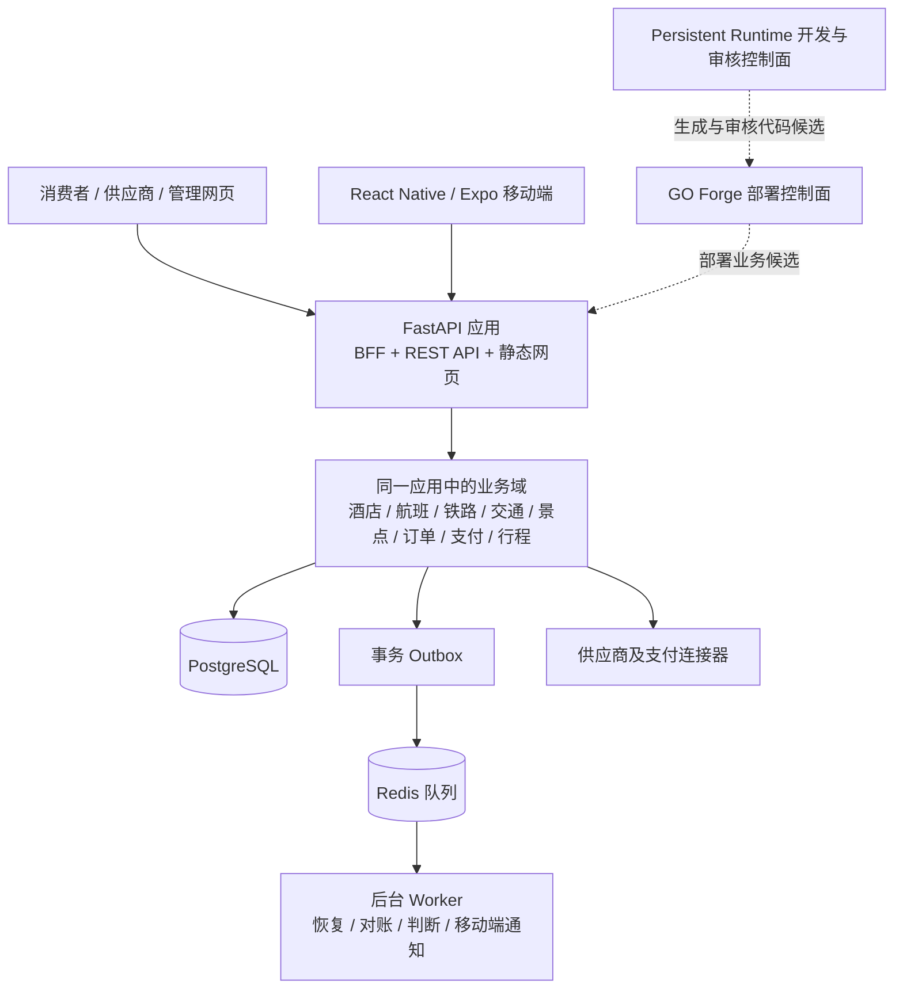

# GO 当前代码架构分析

> 分析日期：2026-10-10  
> 分析范围：仓库中的业务源码、移动端、部署定义和根目录操作规则。本文是代码结构分析，不是运行环境核验，也不替代最新签名 VERIFY Evidence。

## 结论摘要

GO 可以概括成“前端 + 后端”，但更准确的描述是：**多个客户端 + 一个模块化业务单体 + 多个异步 Worker**。消费者、供应商和管理网页，以及 React Native 移动端，共用同一业务后端；后端以一个 FastAPI 应用为核心，内部按业务域分包，并由多个后台进程承担异步工作。

这套设计对于需要快速验证多业态交易、同时共享订单与资金流程的产品是合理的。现阶段不建议仅按目录数量或 Cell 划分立即拆成微服务。主要架构风险是模块边界尚未完全固化：大量路由由单一入口装配，部分接口直接进行数据库访问，多个业务域共用后端发布和数据访问面。

## 当前结构

图中的 GO Forge 和 Persistent Runtime 属于部署、开发和审核控制面，不是消费者预订请求中的业务微服务。旧 Command Center 在根规则中已标为退役路径。

### 客户端和 API

- 网页端分为消费者、供应商和管理端。FastAPI 将这些静态目录挂载在 `/go-app`、`/supplier-console` 和 `/go-admin`，所以这些网页与 API 的生产发布目前耦合在业务后端中。[FastAPI 静态目录挂载](../application/src/go_hotel/main.py#L331)
- 网页 API 客户端使用同源 `/bff/...` 路径，并携带同源会话凭据；移动端是独立的 React Native / Expo 客户端，配置了 `travel.go.consumer` 包名及独立 API 地址。[网页 API 客户端](../application/frontend/shared/api.js)、[移动端配置](../application/mobile/go-app/app.json)、[移动端 API 地址配置](../application/mobile/go-app/app.config.js)
- 因此，GO 不只是“一套网页前端”。它至少有三个网页入口和一个移动端入口；它们复用后端，但不是同一份 UI 代码。

### 业务后端

- `application/src/go_hotel/main.py` 创建一个 FastAPI 应用，并集中注册酒店、航班、铁路、交通、景点、行程、支付、身份、连接器、恢复和运营相关路由。[FastAPI 应用与路由装配](../application/src/go_hotel/main.py#L151)
- `application/src/go_hotel/` 按业务域和技术职责分目录，例如 `flight/`、`rail/`、`mobility/`、`attractions/`、`journey/`、`payments/`、`services/`、`repositories/` 和 `workers/`。这是模块化单体常见的代码组织方式；同一进程内调用不经过网络，不构成独立微服务。
- 目录统计显示 API 路由已有百余个文件。路由集中在一个入口装配，便于统一启动与配置，但入口和模块依赖也容易成为全局耦合点。[路由装配](../application/src/go_hotel/main.py#L164)

### 数据与异步处理

- SQLAlchemy 通过统一的数据库 URL 和 `SessionLocal` 创建数据库会话。[数据库会话配置](../application/src/go_hotel/db/session.py)
- `deploy/hk-staging/docker-compose.business-runtime.yml` 定义一个 `api` 服务和七个 Worker 服务。这些角色使用同一个 `GO_BUSINESS_IMAGE_TAG`，通过不同启动命令运行。因此它们可以按进程角色部署，但不具有独立代码库或独立镜像版本。[业务服务定义](../deploy/hk-staging/docker-compose.business-runtime.yml#L34)
- Outbox Worker、恢复、对账、判断、移动端 engagement 和推送等异步任务从 API 请求中分离。Redis 队列代码将 PostgreSQL/Outbox 定为业务事实来源，将 Redis 作为投递通道。[Redis 队列的数据职责](../application/src/go_hotel/queue/redis_queue.py#L23)
- 订单、支付、供应商履约属于长事务。代码中可见幂等键、外部操作记录和恢复路径，例如酒店预订与授权、扣款分别记录外部操作状态。[预订支付服务](../application/src/go_hotel/services/booking.py#L98)

## 架构是否合理

### 做得合适的地方

1. **先采用模块化单体，避免过早分布式化。** 多业态之间共享用户、订单、支付、售后和统一行程。把这些流程放在一个后端与共同数据访问层，减少远程调用和跨服务一致性成本。
2. **将耗时任务放到 Worker。** 推送、对账、恢复等任务可以异步执行，也能与 HTTP API 使用不同的进程配置。
3. **对外部交易有幂等和恢复意识。** 交易可能在本地提交、供应商响应、支付扣款之间失败；记录操作状态并支持重试/对账，是比同步调用后直接假定成功更稳健的方向。
4. **多个客户端可以复用领域 API。** 网页和移动端共享服务端业务规则，减少同一资金或履约规则在客户端重复实现。

### 主要风险与限制

1. **目录不等于强模块边界。** 路由、服务、ORM 模型之间是否有明确的依赖规则，需要靠架构测试和代码评审保证。当前有些路由会导入 SQLAlchemy 模型和 `SessionLocal`，同时调用多个业务服务；例如 consumer checkout 路由直接查询订单与履约记录，再触发用例逻辑。[Checkout 路由](../application/src/go_hotel/api/routes/consumer_checkout.py#L38)
2. **入口和数据模型集中度较高。** 中央 `main.py` 装配大量路由，数据库模型集中在 `db/models.py`。随着业务域和贡献者增加，改动容易发生跨域协调、启动时全量加载、共享表被多个模块读写等问题。
3. **网页与 API 发布耦合。** 由同一个 API 应用托管静态网页，早期省去了独立 CDN/静态站点发布流程，也自然支持同源会话；代价是页面和后端需要一起发布，前端缓存和扩容策略不能单独演进。
4. **共享镜像不等于独立服务。** Worker 可按角色独立运行，但 API 和所有 Worker 仍随同一业务镜像版本推进。某个 Worker 若需要单独升级或使用不同运行时，当前拓扑没有完整体现这种发布边界。
5. **多业态交易边界要持续收敛。** 酒店、航班、铁路、租车等保留垂直订单差异是合理的；跨业态的支付、资金流水、订单身份和行程状态则需要清晰的唯一事实来源，避免同一业务事实在多个领域模型中各自维护。

总体而言，当前架构适合称为**按领域分模块的业务单体，附带独立运行角色的 Worker**。它有一些微服务化的业务域和异步实践，但尚不能仅凭目录或容器数量称为微服务架构。

## 业界架构对照

- Uber 的 Domain-Oriented Microservice Architecture（DOMA）把相关服务组织成业务域，再用层次和网关管理依赖；其文章也指出，微服务会增加调用链、排障和团队协调成本。对 GO 更有价值的借鉴是领域边界、依赖方向和稳定网关，而非照搬大规模微服务部署。[Uber DOMA](https://www.uber.com/us/en/blog/microservice-architecture/)
- Airbnb 的支付编排演进把资金能力从住宿预订特定逻辑中抽离，转向可供多个产品共用的支付模型，并采用兼容层渐进迁移。这与 GO 需要让酒店、航班、铁路、租车共享资金能力的方向相近。资金域迁移尤其需要兼容和对账，不能只把旧代码换个服务名。[Airbnb 支付编排](https://medium.com/airbnb-engineering/rebuilding-payment-orchestration-at-airbnb-341d194a781b)
- AWS 的 Outbox 指引用于解决数据库写入与消息发布之间的双写问题，并提示消费者要处理重复消息；Saga 用于跨服务长事务的步骤协调和补偿，但会增加调试与设计成本。这些模式适合用来校准 GO 的异步履约和支付恢复边界。[AWS Transactional Outbox](https://docs.aws.amazon.com/en_en/prescriptive-guidance/latest/cloud-design-patterns/transactional-outbox.html)、[AWS Saga 模式](https://docs.aws.amazon.com/prescriptive-guidance/latest/cloud-design-patterns/saga-patterns.html)

这些是公开架构经验，不是 GO 必须照搬的目标架构。GO 的团队规模、流量、故障数据和运维能力才决定拆分时机。

## 建议的演进顺序

1. **先落实模块依赖规则。** 建立清楚的调用方向：HTTP 路由负责协议和输入校验；应用服务编排用例；领域模块拥有业务规则；数据库和供应商连接器通过明确接口提供能力。逐步减少路由直接访问 ORM 和跨模块写表。
2. **明确跨业态共享事实。** 为订单、支付意图、资金流水、履约和行程定义权威状态及状态转换责任；垂直域负责产品差异，公共域负责共用交易规则。明确每张表由哪个业务域拥有写入权。
3. **加固异步处理契约。** 对 Outbox/队列明示重复投递处理、幂等键、重试退避、死信、人工重放和对账责任。跨供应商与支付的长事务可建模为显式流程状态机；只有在服务边界稳定后再考虑 Saga 编排。
4. **按实际需求拆分发布面。** 网页的缓存、发布和扩容确实需要独立管理时，再将静态资源移到 CDN/静态站点；某一后端领域确实需要独立团队、独立扩容和独立故障域时，再把它提为服务。
5. **优先从边界清楚的适配层开始拆分。** 供应商连接器或通知投递通常比支付账务核心更容易形成稳定接口。支付/资金拆分的正确性要求最高，应先建立账本、对账和幂等事实，再迁移。

## 参考携程移动端架构演进的补充判断

携程《移动端架构演进与优化之路》记录的是约 2013–2016 年，面对超大 App、多 BU 并行研发和当时 Android 平台限制所做的演进。其服务端经历了业务解耦、统一网关和服务化；客户端逐步按业务拆分 Bundle，并引入按需加载、动态更新和性能治理。它适合作为识别耦合、发布和性能问题的参照，不应直接作为 GO 的目标架构。参考：[携程移动端架构演进与优化之路](https://www.cnblogs.com/boonya/p/18557931)、[携程移动 App 架构优化之旅](https://www.infoq.cn/article/ctrip-app-architecture)。

### 总体判断

当前没有证据表明 GO 需要推倒重来或立即全面拆成微服务。按业务域组织的 FastAPI 模块化单体，加上按角色运行的 Worker，仍是共享用户、订单、支付和行程能力的合理起点。优先任务是把模块契约、数据责任和发布边界收敛清楚，再根据协作、性能和故障数据判断是否拆分。

| 观察维度 | GO 当前情况 | 判断与后续关注点 |
|---|---|---|
| 业务模块边界 | 业务域已有独立目录，但路由集中在 `main.py` 装配；部分路由直接访问 ORM 或跨域编排 | 目录边界尚不足以保证低耦合。逐步明确路由、应用服务、领域规则、仓储和连接器的依赖方向，并标明共享事实的写入责任 |
| 发布边界 | 消费者、供应商和管理网页由 FastAPI 同应用挂载；API 和七类 Worker 在业务 Compose 中共用镜像 | 当前发布面较集中。只有在独立扩缩容、回滚或发布需求得到实际验证后，才拆分部署单元 |
| 移动端交付 | 移动端使用 React Native / Expo，页面、导航、API、认证和存储有独立目录；现有材料未显示业务 Bundle 可独立远程加载和发布 | 先测量包体、冷启动、页面加载和发布痛点。携程的动态插件化解决了其当时的规模问题，不是 GO 当前必选项 |
| 可观测性 | 后端有请求追踪、日志、指标和事件控制；已读材料尚不能确认移动端性能指标已形成完整闭环 | 按平台、版本、网络和关键页面补齐或核实启动、请求成功率与耗时、崩溃和卡顿等体验数据，再依数据排序优化 |
| 交易能力成熟度 | 仓库有支付、资金流转和恢复相关代码；状态材料指出部分酒店支付流程使用 Mock Provider，不能据此证明真实支付渠道已可用 | 这是外部接入与产品成熟度问题，应与代码架构形态分开评估。跨业态支付事实、幂等和对账责任仍需清晰定义 |
| 运行溯源 | 根 `AGENTS.md` 记录 Persistent Runtime 存在源码来源缺口 | 这是已知的工程治理与运行溯源风险，应如实报告；不因本架构分析而调整主机、删除、重装或试图在无关任务中修复 |

### 建议的落地优先级

1. 明确模块依赖方向，以及订单、支付、履约、行程等跨域事实的权威写入责任。
2. 建立移动端关键体验指标，先用生产或验收数据确认瓶颈，再做针对性优化。
3. 根据变更冲突、回归成本、资源隔离和独立回滚需求，评估 API、Worker 或静态网页的发布边界。
4. 只有在业务团队、故障域和数据边界稳定后，才考虑把特定模块拆成独立服务；只有性能和交付数据支持时，才评估移动端动态 Bundle。

以上结论描述的是仓库源码和部署定义，不等于主机实际运行状态。运行身份仍以最新签名 VERIFY Evidence 为准；支付代码、供应商适配器、测试结果或 Compose 定义也不能单独证明真实外部交易能力已开通。

## 事实边界

本文依据仓库源码和部署定义判断代码形态。Compose 文件说明仓库侧的业务运行定义，不证明主机当前运行的具体镜像、服务集合或外部供应商是否已启用。运行环境身份仍应以最新签名 VERIFY Evidence 为准。源码中某些 checkout 路由明确为合同模拟器，也不能据此推断其他路由的真实供应商或支付能力。

## 代码入口

- [GO 代码结构说明](GO_代码结构说明.md)
- [FastAPI 主入口](../application/src/go_hotel/main.py)
- [业务部署定义](../deploy/hk-staging/docker-compose.business-runtime.yml)
- [数据库会话](../application/src/go_hotel/db/session.py)
- [异步队列](../application/src/go_hotel/queue/redis_queue.py)
- [酒店预订服务](../application/src/go_hotel/services/booking.py)
- [消费端 Checkout 路由](../application/src/go_hotel/api/routes/consumer_checkout.py)
