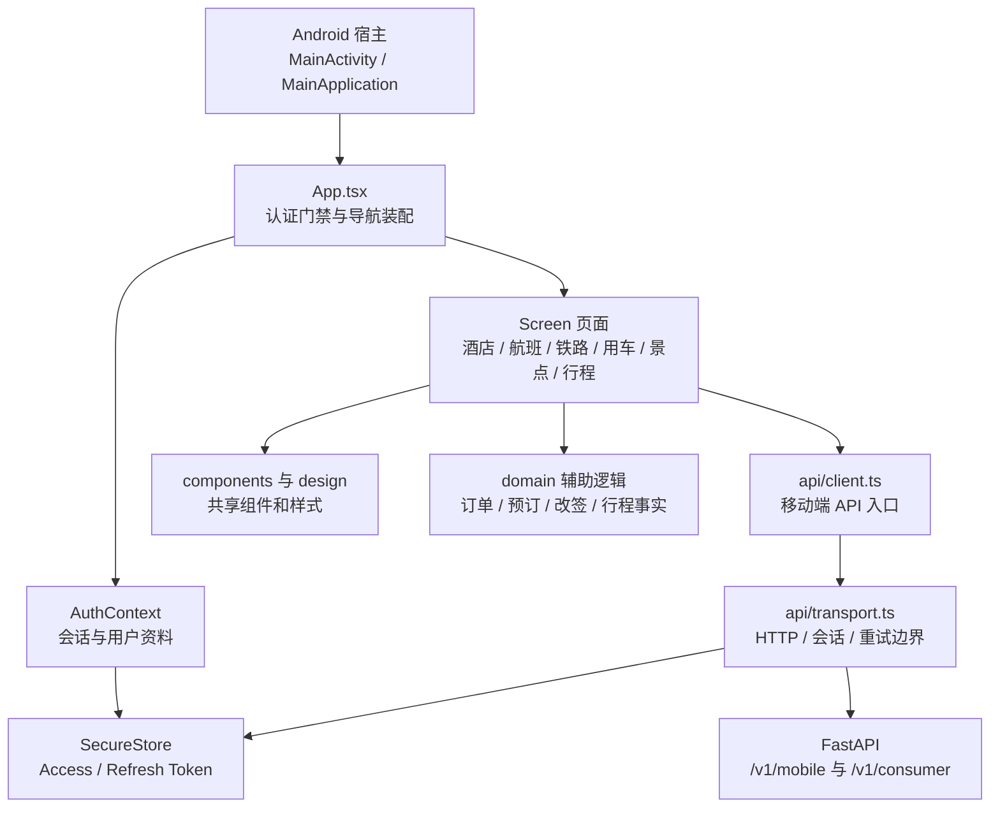

# GO 移动端前端代码设计说明

> 范围：`application/mobile/go-app/` 下的消费者移动端，重点说明 React Native / Expo 客户端和 Android APK 的代码关系。
> 适用快照：2026-10-11 工作区代码。
> 本文是源码导览，不是发布批准，也不证明真机验收、真实供应商履约或真实支付已经通过。

## 1. 先理解整体结构

GO 移动端不是把网页装进 WebView 的 APK。业务 UI 使用 React Native，以 TypeScript / TSX 编写；Android 原生工程负责应用生命周期、系统入口和加载 React Native。网页消费者端位于 `application/frontend/consumer/`，与这个移动 App 是两份不同的 UI。



可以先记住五层：

1. **原生宿主**：Android Activity/Application、Manifest、Gradle。
2. **应用装配**：`App.tsx`，管理登录门禁、Tab 和页面 Stack。
3. **页面展示**：`src/screens/`，每个页面负责一个用户界面。
4. **共享客户端能力**：`src/api/`、`src/auth/`、`src/storage/`、`src/notifications/`、`src/navigation/`。
5. **业务辅助与视觉规范**：`src/domain/`、`src/components/`、`src/design.ts`。

## 2. 目录地图

| 路径 | 内容 | 阅读时要回答的问题 |
|---|---|---|
| `App.tsx` | React Native 根组件、认证门禁、底部 Tab、Stack 页面注册、App Open 和通知响应 | 应用启动后如何决定显示登录页或业务页面？页面如何进入导航？ |
| `src/screens/` | 酒店、机票、铁路、租车、接送、景点、行程、账户等页面 | 每一步显示什么、用户可以做什么、页面调用哪个 API？ |
| `src/components/` | 网络状态、订单动作、基础 UI、酒店票规等复用 UI | 哪些 UI 和交互被多个页面共用？ |
| `src/design.ts` | 颜色、尺寸、字体和公共样式 | 视觉规范从哪里取？ |
| `src/domain/` | `orderActions`、`bookingIntent`、`requestFingerprint`、`changeActions`、`tripFacts`、`stayCreditActions` 等 | 哪些规则/状态计算从具体页面提取出来？ |
| `src/auth/` | `AuthContext.tsx` | 登录状态如何恢复、登录、退出以及通知页面刷新？ |
| `src/api/` | `client.ts`、`transport.ts`、`network.ts` | HTTP 请求、鉴权、超时、幂等和离线如何处理？ |
| `src/storage/` | `secureSession.ts` | 敏感会话令牌保存在哪里？ |
| `src/navigation/` | `linking.ts` | 系统链接/推送链接如何映射到页面？ |
| `src/notifications/` | `registerPush.ts`、`pushLifecycle.ts` | 如何请求推送权限、注册设备并处理通知？ |
| `android/` | Android Studio / Gradle 工程 | Android 如何启动 JS 应用、使用哪些原生模块和应用标识？ |
| `assets/`、`native/apple/` | 图片、品牌素材及 Apple 原生文件 | 哪些资源随 App 打包？平台专属代码在哪里？ |
| `qa/`、`store/`、`scripts/` | 验收矩阵、恢复约定、隐私/发布清单和检查脚本 | 发布前有哪些契约、真机和商店门槛？ |

## 3. 启动过程：从 Android 到第一个页面

### 3.1 Android 原生入口

- `android/app/src/main/AndroidManifest.xml` 将 `.MainApplication` 和 `.MainActivity` 注册为应用入口，声明包标识 `travel.go.consumer`、启动 Activity 和链接入口。
- `MainApplication.kt` 创建 React Native Host，自动发现 React Native / Expo 原生模块，并在应用启动时初始化 SoLoader 和 Expo 生命周期。
- `MainActivity.kt` 返回 React Native 主组件名 `main`。Expo 的 Gradle 插件和 AppEntry 会把这个名称连接到 JS 根组件。

业务界面主要在 TSX 中；这两个 Kotlin 文件负责把 Android 生命周期接到 React Native，不承载酒店或机票的业务流程。

### 3.2 `App.tsx` 的启动和认证门禁

`App.tsx` 大致有三部分：

1. 用 `createBottomTabNavigator()` 创建 Home、Search、Trips、Wallet、Profile 五个底部入口。
2. 用 `createNativeStackNavigator()` 注册酒店、航班、铁路、交通、景点、行程、订单和售后等页面。
3. 外层挂载 `AuthProvider`。认证状态加载时显示 `SplashScreen`；未认证显示 `LoginScreen`；通过认证后才渲染 `NavigationContainer`、Tab 和业务 Stack。

应用进入已登录区域后，`EngagementBootstrap` 会调用 `/v1/mobile/app-open`；若返回 Quick Review 意图且含有 `deep_link`，会打开该链接。它也注册通知响应监听器，收到带 `deep_link` 的通知后交给 Expo Linking 处理。

因此，`App.tsx` 是**根组件、全局门禁和导航目录**。具体页面逻辑在 `src/screens/` 中。

## 4. 页面和导航如何对应业务

页面采用“一个主要页面一个文件”的组织方式，文件名可以直接作为业务阅读入口。常见垂直域包括：

| 业务 | 可按命名查找的典型页面 |
|---|---|
| 酒店 | `SearchScreen`、`HotelListScreen`、`HotelDetailScreen`、`RoomsScreen`、`BookingReviewScreen`、`PaymentScreen`、`BookingSuccessScreen` |
| 航班 | `FlightSearchScreen`、`FlightResultsScreen`、`FlightFareScreen`、`FlightReviewScreen`、`FlightPaymentScreen`、`FlightTripDetailScreen`、`FlightChangeScreen`、`FlightRefundScreen` |
| 铁路 | `RailSearchScreen`、`RailResultsScreen`、`RailFareScreen`、`RailReviewScreen`、`RailPaymentScreen`、`RailTripDetailScreen`、`RailChangeScreen`、`RailRefundScreen` |
| 租车 / 接送 | `Rental*Screen`、`Ride*Screen`、`MobilityTripDetailScreen`、`MobilityRefundSuccessScreen` |
| 景点 | `Attraction*Screen`，覆盖搜索、详情、下单、订单、改签/退款等页面 |
| 统一行程与恢复 | `TripsScreen`、`JourneyDetailScreen`、`JourneyDisruptionScreen`、`JourneyRecovery*Screen` |
| 账户与权益 | `ProfileScreen`、`WalletScreen`、`StayCreditScreen`、`TravelProfile*Screen`、`NotificationsScreen` |

从代码阅读上，建议把一条用户路径按页面顺序追踪，而不是先按后端 Cell 或仓库目录推断 UI。酒店路径可以从 `HomeScreen` / `SearchScreen` 开始，再看列表、详情、房型、预订确认、支付和成功页；订单完成后的路径从 `TripsScreen` 或 `OrderDetailScreen` 进入取消、改签或退款页面。

垂直页面虽然按文件拆开，但页面注册仍集中在 `App.tsx`。跨页面共用动作可以查看 `src/components/OrderActions.tsx` 和 `src/domain/` 中对应的 helper；真正的状态转换和资金事实仍以服务端响应为准。

## 5. 登录与会话恢复

### 5.1 `AuthContext.tsx`

`AuthProvider` 持有 `ready`、`profile` 等应用级认证状态，并向子页面暴露 `login`、`logout`、`reload`。

启动时执行 `reload()`：

1. 记录当前 session generation。
2. 通过 `secureSession.accessToken()` 检查本地 Access Token。
3. 没有令牌时清空 profile；有令牌时请求 `/v1/consumer/me` 恢复用户资料。
4. 只有当期间 session generation 没变化时，才把返回资料写入当前 UI 状态，避免旧会话响应覆盖新登录状态。
5. `finally` 中将认证初始化标记为完成，使根组件可以离开 Splash 状态。

登录流程调用 API 层完成服务端登录和令牌保存，然后再次 `reload()` 以拉取 profile。退出时调用传输层 logout；即使服务端登出请求失败，本地令牌仍会先被清掉，防止 UI 继续保留旧账户。

### 5.2 `secureSession.ts`

Access Token 和 Refresh Token 通过 `expo-secure-store` 保存，不放在普通 AsyncStorage。Android 的原生备份规则也排除了 SecureStore 对应数据。

## 6. API 客户端：从页面请求到 HTTP

### 6.1 两个职责文件

- `src/api/client.ts` 读取 Expo `extra.apiBaseUrl`，创建 transport，并导出页面使用的 `api`、`login`、`logout` 等函数。
- `src/api/transport.ts` 是与 React 组件分离的 HTTP/session 状态机。`createTransport()` 接收 `fetch`、网络状态检查、令牌读写和幂等键生成器等依赖，因此测试可以注入替代实现。

主要请求目标是 `/v1/mobile/...` 和 `/v1/consumer/...`。客户端限制 API path 必须是本地 `/v1/` 路径，不接受完整外部 URL。

### 6.2 一次请求的处理顺序

```text
页面调用 api(path, options)
  → 检查路径格式
  → 等待先前排队的令牌写入完成
  → 检查 session generation 和认证状态
  → 检查设备网络是否可用
  → 读取 Access Token 并设置 Authorization
  → 写请求补 Idempotency-Key
  → AbortController 超时控制（默认 20 秒）
  → fetch 并解析 JSON
  → 401 时单航班刷新令牌，再以原请求重试一次
  → 返回业务数据，或返回带状态码/不确定标志的 RequestError
```

### 6.3 重要错误语义

- `NETWORK_OFFLINE`：NetInfo 认为设备离线，请求尚未发送。
- `NETWORK_REQUEST_FAILED`：读请求传输失败。
- `NETWORK_RESULT_UNKNOWN`：写请求发送后发生网络错误，客户端不能确定服务端是否完成了操作；错误带 `uncertain` 标志。
- `SESSION_EXPIRED` / `SESSION_CHANGED`：会话失效或请求跨越账户切换，不应把旧响应混入当前账户。
- 非幂等键保护下，mutating request 会自动得到一个 `Idempotency-Key`。认证刷新重试复用同一份请求参数，避免变成第二笔独立操作。

`src/api/network.ts` 提供 NetInfo 在线判断、幂等键生成和 AsyncStorage 中的非敏感 retry queue 工具。**工具存在不代表所有写操作都会离线排队**；`qa/NETWORK_RECOVERY.md` 明确要求预订、支付、改签、取消和退款等资金相关变更不能盲目离线重放，恢复网络后应读取服务端最新订单/报价状态。

## 7. 业务辅助、组件和数据状态

### 7.1 `src/domain/`

当前目录包含：

- `bookingIntent.ts`：预订意图相关逻辑；
- `orderActions.ts`、`changeActions.ts`、`stayCreditActions.ts`：订单、改签和住宿权益相关动作/helper；
- `requestFingerprint.ts`：请求指纹辅助逻辑；
- `tripFacts.ts`：行程事实辅助逻辑。

这些文件提供了从页面中抽出部分规则的落点。追具体功能时，要从目标 Screen 查它是否调用对应 helper，再沿 helper 找 API 调用；不能仅因文件存在就假定每个页面都遵守统一调用路径。

### 7.2 `src/components/` 与 `src/design.ts`

`UI.tsx`、`GO.tsx` 等放共享视觉控件；`NetworkStatus.tsx` 显示联网状态；`OrderActions.tsx` 汇集订单相关 UI 动作；`HotelFareTerms.tsx` 展示酒店票规类内容。颜色、字体、间距等共享 token 在 `design.ts`。

页面仍是主要的业务组合单元。具体页面是否把数据获取、字段映射、动作规则和 UI 拆得足够清楚，需要逐页阅读源文件确认。

## 8. 推送和深链

- `app.json` 声明 `go` 自定义 scheme，以及 `https://go.travel/app` 的 Android App Link。
- `src/navigation/linking.ts` 为 React Navigation 提供链接到页面的映射；仓库 README 中的通知示例会把订单或 review deeplink 送回 App。
- `registerPush.ts` 在真实设备上请求通知权限，取得系统 Push Token，并把设备/平台/版本信息发给 `/v1/mobile/devices`。模拟器路径会返回 `PHYSICAL_DEVICE_REQUIRED`。
- `App.tsx` 的 `EngagementBootstrap` 处理 app-open 返回的 deep link，以及通知点击后的 `deep_link`。
- `pushLifecycle.ts` 也提供通知生命周期监听工具。阅读某条推送是否真的会触发 UI 跳转时，应继续确认注册函数的调用方、后端 payload 和 `linking.ts` 的 route map。

## 9. Expo 与 Android APK 的构建关系

### 9.1 依赖与脚本

`package.json` 当前声明 Expo `~53.0.0`、React Native `0.79.0`、React `19.0.0`、React Navigation、SecureStore、Notifications、NetInfo 等依赖。常用脚本包括：

| 命令 | 用途 |
|---|---|
| `npm run start` | 启动 Expo/Metro 开发服务器 |
| `npm run android` | 调用 Expo 运行 Android 原生工程 |
| `npm run typecheck` | TypeScript 类型检查 |
| `npm run test:contract` | 运行移动端 API/契约脚本 |
| `npm run build:android:preview` | 使用 EAS `preview` profile 构建 Android 预览包 |
| `npm run build:android:production` | 使用 EAS `production` profile 构建 Android 发布包 |

### 9.2 配置如何合并

- `app.json` 提供 Expo 静态配置：App 名称、slug、scheme、iOS Bundle ID、Android package、通知/SecureStore 插件和深链声明。
- `app.config.js` 在构建时绑定 API 地址。`preview` / `production` profile，或 `staging` / `production` 环境，必须提供 `EXPO_PUBLIC_API_URL` 或 `EXPO_PUBLIC_API_BASE_URL`；外部环境必须是 HTTPS 且不能指向 localhost、环回或无效域名。
- `eas.json` 定义 development、preview、production 三个 EAS profile。Preview 是 internal distribution 并指定 Android APK；Production 的 submit 配置当前仍有应用商店占位信息。
- `android/settings.gradle` 使用 Expo/RN Gradle 插件和 autolinking；`android/app/build.gradle` 将 Expo CLI `export:embed` 配置为打包命令。实际是否生成内置 JS bundle 还取决于 variant：该工程默认 `debug` 是 debuggable variant，会跳过 JS bundle 打包；release variant 才会在构建时导出 JS bundle 和静态资源。

### 9.3 Android Debug APK 的 Metro 加载流程

该工程用 `:app:assembleDebug` 生成的 APK 是调试包。React Native Gradle 插件默认把 `debug` 视为 debuggable variant，因此 Debug APK 不包含可独立运行的 `index.android.bundle`。启动时 Native React Native DevSupport 会请求开发机上的 Metro；如果 Metro 没运行、手机访问不到开发机，或 Metro 打包失败，应用就会显示：

```text
Unable to load script. Make sure you are either running Metro or that your bundle 'index.android.bundle' is packaged correctly for release.
```

本次真机问题包含两个环节：最初 Debug APK 没有连接可用的 Metro；启动 Metro 后，打包又因本地 `node_modules` 缺少 `caniuse-lite/dist/unpacker/agents` 失败。按 `package-lock.json` 执行 `npm ci` 后 Metro 成功打包。判断问题时应区分“Metro 服务不可达”和“Metro 可达但 bundle 构建失败”：`http://127.0.0.1:8081/status` 返回 `packager-status:running` 只能证明服务在监听，不代表 JS bundle 已构建成功。

#### 推荐的构建、安装、启动方式

在仓库根目录执行：

```powershell
.\application\mobile\go-app\scripts\build-install-android.cmd -Launch
```

脚本的执行顺序如下：

1. 调用 Gradle `:app:assembleDebug` 生成 `android/app/build/outputs/apk/debug/app-debug.apk`。
2. 通过 `adb devices -l` 检查设备状态；唯一设备会自动选择，多台设备时要求显式传 `-DeviceSerial <serial>`。
3. 用 `adb install -r` 安装 APK。
4. 当传入 `-Launch`（或 `-Logcat`）时，检查电脑 `127.0.0.1:8081/status`。Metro 未运行就从移动端目录启动 `npm run start -- --localhost --port 8081`。
5. 调用 `adb -s <serial> reverse tcp:8081 tcp:8081`，将手机访问的本机 8081 转到开发机 Metro，然后启动 `travel.go.consumer`。

如果只需要构建/安装、不启动应用，可省略 `-Launch`；`-NoInstall` 只构建 APK，不检查设备、不安装。需要指定后端地址时使用 `-ApiBaseUrl <https-url>`。例如：

```powershell
.\application\mobile\go-app\scripts\build-install-android.cmd -DeviceSerial 3508679531000JO -ApiBaseUrl https://api.example.com -Launch
```

`-Logcat` 会在启动后采集默认 120 秒设备日志；可用 `-LogcatSeconds <秒数>` 调整时长。设备日志保存在系统临时目录的 `go-mobile-android-logs` 下。脚本自动启动的 Metro 日志也保存在该目录，文件为 `metro-8081.log` 和 `metro-8081-stderr.log`。Metro 进程需保持运行，Debug APK 才能继续加载/重载 JS；停止 Metro 后再次打开 Debug APK 会重新出现脚本加载错误。

#### 手动排查

从移动端工程目录启动 Metro：

```powershell
cd application/mobile/go-app
npm ci
npm run start -- --localhost --port 8081
```

另开终端确认 Metro 状态并配置设备端口转发：

```powershell
Invoke-WebRequest -UseBasicParsing http://127.0.0.1:8081/status
adb devices -l
adb -s <serial> reverse tcp:8081 tcp:8081
```

如果状态是 `packager-status:running` 但仍不能加载，观察 Metro 终端的首次 `Android Bundling` 输出。若出现 `Cannot find module 'caniuse-lite/dist/unpacker/agents'`，在 `application/mobile/go-app` 执行 `npm ci` 恢复 lockfile 中的依赖，再重启 Metro。`npm ci` 会按锁文件重建 `node_modules`；不要用 `npm audit fix` 代替依赖恢复，因为它可能改变依赖版本。

脚本启动 Expo CLI 时设置 `EXPO_NO_TYPESCRIPT_SETUP=1`，避免 Expo 启动时自动改写仓库的 `tsconfig.json`。Debug APK 与 Release APK 的 JS 加载方式不同：Debug 依赖开发机 Metro；Release 应验证最终 APK 内含 bundle，并按正式签名与发布流程验收。

### 9.4 当前代码中需要知道的发布配置事实

- Android Manifest 将 `expo.modules.updates.ENABLED` 设为 `false`。因此不要仅凭 `eas.json` 中有 channel 就认为这个 Android 工程已启用 Expo OTA 更新。
- `android/app/build.gradle` 的 `release` build type 当前显式使用 `signingConfigs.debug`。这是仓库里的原生构建配置事实；正式发布需要确认/替换为受控 release 签名配置并核对最终构建实际使用的签名。
- 版本字段分布在 `package.json`、`app.json`、`app.config.js` 和 Gradle。`app.config.js` 返回 Expo version `1.1.0`，Gradle versionName 也是 `1.1.0`，而 `app.json` 原始 version 是 `1.0.0`；发包流程应明确哪个字段是应用版本来源，以及 versionCode 如何递增。
- `AndroidManifest.xml` 中有外部存储和 SYSTEM_ALERT_WINDOW 权限；调试 Manifest 另有 cleartext 流量声明。应区分 debug 与 release 的 Manifest 合并结果，并确认发布包只保留业务必需的权限和网络策略。

## 10. 从页面追到后端的实用读法

以一个功能为单位按下面顺序追踪：

1. 在 `src/screens/` 找到用户看到的 Screen。
2. 找出点击事件调用的 domain helper 或 `api(...)` 路径。
3. 如果经过 helper，先读其输入/返回值，再看它如何构造请求或判断状态。
4. 沿 `src/api/client.ts` 进入 `transport.ts`，确认鉴权、幂等、超时和错误语义。
5. 用请求路径搜索后端 `application/src/go_hotel/api/routes/` 对应路由。
6. 继续读后端服务的真实动作边界，区分模拟供应商/模拟支付与真实外部执行器。
7. 检查页面完成后状态放在哪里：本地 React state、认证 context，还是重新读取服务端订单/行程。

例如酒店预订可从 `HotelDetailScreen` 或 `RoomsScreen` 进入，继续读 `BookingReviewScreen`、`PaymentScreen`、`BookingSuccessScreen`，然后看 `TripsScreen` / `OrderDetailScreen` 和售后页面。机票、铁路和景点有相似的页面序列，但各自报价、乘客、凭证和售后规则不同，不能把 UI 相似误认为后端合同完全相同。

支付尤其要同时读客户端和服务端。客户端有 Payment 页面只说明它有界面和调用入口；后端移动交易实现中的 `external_live` / 支付 readiness 才能判断真实执行能力。合同模拟器流程、供应商测试数据和真实支付属于不同能力等级。

### 10.1 酒店：搜索、报价、预订与支付的实际代码链

下面这条链可以作为读整个前端的样板。它同时经过页面本地 state、React Navigation 参数、API transport、domain 校验和订单重读。

| 步骤 | 代码位置 | 实际职责与输入输出 |
|---|---|---|
| 搜索条件 | `src/screens/SearchScreen.tsx` | 目前目的地、入住/离店日期主要保存在该屏组件 state；点击搜索时把 `city`、`cityLabel`、`checkIn`、`checkOut` 等放进 `HotelList` 路由参数。人数/筛选等 UI 中有静态演示值，不能据此认定已经接入可编辑筛选器。 |
| 酒店列表 | `src/screens/HotelListScreen.tsx` | 首次挂载时读路由参数，POST `/v1/search/hotels`，请求体包含 `destination.city_code`、`stay`、`occupancy`、`currency`。响应的 `data.hotels` 放入 `items`，并将界面状态设为 `ready` 或 `empty`；网络/API 异常设为 `error`，可点重试重新调用。选中卡片后传递 `hotelId` 和可能存在的 `best_offer.offer_id` 到 `HotelDetail`。 |
| 酒店详情 | `src/screens/HotelDetailScreen.tsx` | 以 `hotelId` 请求 `/v1/consumer/hotels/{hotelId}`，本地 `d` 保存返回详情，`error` 表示加载问题；页面区分加载、错误和详情展示。由详情进入房型/方案页时继续传 hotel 数据。 |
| 房型/报价 | `src/screens/RoomsScreen.tsx` | 优先使用导航参数里已有的 `hotel.offers`；为空时再请求 `/v1/hotels/{id}/offers`。从响应中保存 offers、loading/error 状态。选中方案后导航到 `HotelCompare`，传入 `hotel`、`offers` 和所选 `offer`。 |
| 价格复核 | `src/screens/HotelCompareScreen.tsx` | 展示房型、币种/总价、餐食与取消规则。点击选择时 POST `/v1/offers/{offer_id}/prebook`，请求中带报价币种；只有这次预订前核验成功，才把返回的 `prebook.data` 连同 hotel/offer 传入 `BookingReview`。失败用 Alert 告知价格或库存核验未通过。 |
| 预订确认 | `src/screens/BookingReviewScreen.tsx` | 从 route params 读取 hotel、offer、prebook，显示核验后的价格及有效期/状态提示；点击继续时传给 Payment。该页本身不负责创建订单。 |
| 订单创建和付款 | `src/screens/PaymentScreen.tsx` → `CheckoutScreen.tsx` | `PaymentScreen` 只是把 `vertical="HOTEL"` 传给共享 CheckoutScreen。无 `orderId` 时先读 `/v1/consumer/profile/vault` 获取旅客资料，选择旅客并确认资料使用；酒店还要求确认 fare rules。创建逻辑由 `bookingIntent()` 校验并构造请求。创建成功后保存 `orderId`、更新导航参数，并提示“订单已建立；请核对最新金额后单独确认支付”。有 `orderId` 时通过 `checkoutView()` 读取订单和支付能力；支付按钮只有在订单可支付、模拟器能力可用时启用。 |
| 成功/订单状态 | `src/screens/BookingSuccessScreen.tsx`、`src/screens/OrderDetailScreen.tsx` | 成功页按 `orderId` 再读 `/v1/consumer/orders/{id}/detail`；不能读取时显示状态未确认，不把客户端上一步的请求成功当作最终订单事实。 |

当前搜索屏的日期默认值、列表页中的展示文案与服务端实际响应是两类数据。分析业务事实时，以 API 返回的 offer/order 字段为准；分析现有 UI 行为时，则应注意静态 state、演示按钮与真实交互入口的区别。

### 10.2 `CheckoutScreen`：先建立订单，再做独立支付

共享结算组件通过 `vertical` 参数复用酒店、机票等页面。它的核心 state 可以按用途分成四组：

| state/ref | 用途 |
|---|---|
| `id`、`view` | 当前订单 ID 和由 `checkoutView()` 装配的订单/支付能力视图。 |
| `travelers`、`selected`、`consent`、`fareConfirmed` | 新建订单所需的旅客选择、资料使用确认；酒店另有票规确认。 |
| `loading`、`busy`、`error`、`notice` | 区分读取中、动作中、阻断原因和需要用户核对的结果。 |
| `sequence`、`operation`、`creationUnknown` | 避免页面过期响应覆盖新状态、避免并发重复点击；写请求结果不确定时阻止再次创建。 |

页面获得焦点时运行 `load()`：递增 `sequence` 并捕获 `sessionVersion()`；若已有订单 ID，就用 `checkoutView(orderRef(...), api)` 重新读取订单；否则读旅客资料 vault。异步返回前检查 screen ticket 和 session version，避免用户切换订单/账户之后旧请求仍更新当前屏幕。`useFocusEffect` 使用户返回该页时再次刷新。

创建订单的大致调用顺序是：

```text
用户选择旅客并确认资料使用
  → create() 检查 operation / creationUnknown
  → bookingIntent(vertical, params, userId, selected, consent, fareConfirmed)
  → bookingIntent 校验报价引用、旅客、同意状态及垂直域条件
  → api(intent.path, intent.init)
  → 记录返回 order_id，写入 screen state 和 navigation params
  → 显示“订单已建立，需单独核对金额并支付”
```

`bookingIntent.ts` 按业务垂直域构造不同请求，不是所有订单都共用一条后端路径：酒店使用 `/v1/consumer/orders`，并要求新鲜 `prebook_id`、主旅客、`expected_fare_rule_hash` 和 `fare_confirmed`；机票/铁路分别走各自订单端点并提交旅客与 prebook 引用；景点验证日期、数量和同行人数；租车/接送校验各自报价与搜索字段。它生成的幂等键基于垂直域及请求指纹，格式以 `native-create:<vertical>:<fingerprint>` 为基础。`requestFingerprint.ts` 是可移植的 SHA-256 实现，注释限定其用途是非机密请求身份，不是认证或签名。

如果创建请求发生网络异常且 transport 标记 `uncertain`，`CheckoutScreen` 会把 `creationUnknown` 锁住并提示去 GO Trips 查原订单，不允许用户在当前页面盲目再创建一次。这处理的是“服务端可能已完成但客户端没收到响应”的情况。

支付是另一个明确动作：`createOrderActions(api, current).pay(...)` 会重读订单，验证订单身份、状态和模拟支付能力；金额必须仍与用户所见一致。随后 POST `/v1/consumer/checkout/{vertical}/{orderId}`，传递 `CONTRACT_SIMULATOR` 和确定性幂等键。请求后无论成功或结果不确定，都会重读同一个订单；UI展示重读后的事实和核对提示。这里代码标明的是合同模拟器闭环，不等于真实扣款或出票。

### 10.3 订单 helper 如何集中支付、退款和详情规则

`src/domain/orderActions.ts` 把垂直域映射集中起来：订单引用校验、详情 API 路径、详情屏目标、可支付/可退款状态判断、CNY 最小货币单位金额校验。`checkoutView()` 把订单详情与 `/v1/consumer/checkout-capabilities` 的能力响应合并，只有响应明确是模拟器且 `external_live` 为 false 时才把当前动作呈现为模拟支付。

`createOrderActions()` 再提供页面可调用的操作：

1. **支付**：重新读取订单 → 确认订单 ID/垂直域 → 确认仍可支付且金额未变化 → 提交带幂等键的模拟支付 → 重新读取订单。写请求若超时，返回“结果待核对”，而不是直接再发一笔。
2. **退款**：先取退款 quote；验证 quote 的订单、币种、退款金额、费用、hash、有效期和条款；酒店还读取不可变 quote 并校验 hash/过期时间；用户接受的 quote 与提交时参数必须一致。之后用基于 quote/请求身份的幂等键提交，并重新读取订单。
3. **详情**：按垂直域解析 endpoint，读取服务端订单详情，再核对响应中的订单 ID 和垂直域，避免把错误订单数据渲染到当前页面。

组件 `src/components/OrderActions.tsx` 根据 helper 给出的当前订单状态决定是否显示付款或退款入口，并按垂直域导航到对应屏幕。页面按钮隐藏/禁用属于 UI 约束；服务端仍是最终状态权威。

### 10.4 改签是“报价—确认—提交”三段状态机

`src/domain/changeActions.ts` 配合改签页面实现以下顺序：

```text
读取原订单及 checkout capability
  → 校验当前垂直域支持、订单已确认/已出票、日期/时间格式等
  → 对多航段机票要求明确航段
  → 请求改签 quote，并验证 quote 归属、有效期、金额、币种和摘要
  → 将已展示且用户接受的 quote 保存在 helper 闭包状态
  → 用户提交时要求显式 confirmed，参数与接受时完全一致，quote 仍有效
  → 先消费 accepted quote/consent，再发写请求，防止超时后自动重放
  → 幂等提交，随后重新读取原订单并报告最新状态
```

该 helper 仅在模拟器能力允许时开放相应动作。提交请求出现超时或连接中断时，UI需要回到原订单核对结果，不能将“已发出请求”描述为“改签已完成”。配置目前覆盖 HOTEL、FLIGHT、RAIL、ATTRACTION、RENTAL；各垂直域对日期、航段或报价参数的要求由配置及校验分支决定。

### 10.5 机票路径说明页面拆分与当前静态项

机票路径可用来对照酒店的“页面/报价/订单”结构：

| 页面 | 当前实现要点 |
|---|---|
| `FlightSearchScreen.tsx` | 维护出发地、到达地、日期等本地 state；搜索时 POST `/v1/flights/search`，以响应中的 items 导航到结果页。当前默认示例为 PVG → NRT 和固定日期，舱等/旅客等部分控件仍为固定 UI 值。 |
| `FlightResultsScreen.tsx` | 从 route params 读取 `items` 并展示航司、航段、总价、行李和退改规则；选中 item 后传到 `FlightFare`。标题/日期等展示中仍有固定示例文本，不能全部视为由搜索结果动态生成。 |
| `FlightFareScreen.tsx`、`FlightReviewScreen.tsx` | 继续向用户展示报价与旅客/规则复核；沿按钮 handler 确认 offer 如何进入 prebook 和 checkout params。 |
| `FlightPaymentScreen.tsx` | 复用 `CheckoutScreen`，传 `vertical="FLIGHT"`；创建请求和订单动作因此共享 UI 状态机，但由 `bookingIntent`、`orderActions` 按 FLIGHT 分支构造/校验。 |

由此可见，代码的复用边界主要在传输、结算和订单 helper；搜索条件、offer 展示及各垂直域的报价含义仍由各自 Screen 与 domain 分支处理。复用结算组件不代表酒店报价合同和航班报价合同相同。

### 10.6 读代码时优先定位的 handler 和状态

遇到具体页面时，按以下顺序读比只看 JSX 更容易还原行为：

1. 组件函数参数：看是否接收 `route`、`navigation`、`vertical`，确定输入从哪里来。
2. `useState` / `useRef`：区分界面数据、页面状态和并发/请求保护标志。`useRef` 改动通常不会直接触发重渲染。
3. `useEffect` / `useFocusEffect`：找首次载入与每次回到屏幕时的请求触发时机。
4. 用户事件 handler：从 `onPress` 进入 `load`、`choose`、`create`、`pay` 等函数，再列出其中的校验、请求和导航。
5. 所有 `api(...)` 路径：记录 HTTP method、请求 body 和响应字段；随后沿 `client.ts` → `transport.ts` 查鉴权、幂等和错误行为。
6. `navigation.navigate` / `setParams`：记录屏幕间传值。当前不少页面通过 `any` 类型的 route/navigation 和对象参数传值，阅读时需要自行追踪字段名；这是可维护性改进点。
7. 成功与失败分支：确认是否重新读订单、如何表示 uncertain、是否允许重试，以及 UI 文案是否准确表达“已完成”或“待核对”。

这个方法也能区分三类实现：真实 API 流程、前端本地演示值、仅有页面/路由但尚未接通完整交互。不要只根据屏幕文件存在或按钮文字推断功能已经端到端完成。

## 11. 当前代码设计的长处与需留意处

### 长处

- 移动 App 是独立 React Native 客户端，不依赖网页 UI 才能呈现原生页面。
- 登录状态、请求传输、SecureStore 和网络状态有独立模块，页面不用自行实现令牌轮换。
- 写请求具备幂等键和不确定结果语义，对预订/支付这种不可随意重复的动作是重要基础。
- Screens 按业务步骤拆文件；共有 UI、业务 helper 和平台模块也有各自目录。
- 构建时校验外部 API URL，减少将预览/生产包错误连到本机地址的风险。

### 需要持续治理

1. `App.tsx` 同时维护大量静态 import 和导航注册，适合作为当前统一入口，但会随着业务继续增加而变得难维护；可逐步按业务域抽出 Navigator 和 route param 类型。
2. 当前 Screen 目录按页面平铺，业务域在文件命名中体现；如果页面持续增加，可按 hotel/flight/rail 等 feature 组织页面和局部组件，减少导航与功能代码互相穿插。
3. `domain/` helper 已存在，但需要以实际引用关系为准，持续避免业务状态判断散落在多个 Screen 中。
4. 当前资料没有提供 APK 体积、冷启动、页面首屏、崩溃或真机流量的实测结果；任何“性能已经达标/不达标”的判断都应等设备和构建数据。
5. `qa/REAL_DEVICE_MATRIX.md` 是项目的发布门槛清单；源码可读、TypeScript 通过或 APK 成功生成，都不能代替其真实设备/Staging 验收。

## 12. 建议的阅读顺序

1. `App.tsx`：掌握启动门禁、Tab 和 Stack。
2. `src/auth/AuthContext.tsx`：理解启动恢复、登录和退出。
3. `src/api/client.ts`、`src/api/transport.ts`、`src/storage/secureSession.ts`：理解 API 和安全会话。
4. `HomeScreen.tsx`、`SearchScreen.tsx`、`HotelDetailScreen.tsx`、`RoomsScreen.tsx`：理解浏览和选择。
5. `BookingReviewScreen.tsx`、`PaymentScreen.tsx`、`BookingSuccessScreen.tsx`：理解预订提交入口。
6. `TripsScreen.tsx`、`OrderDetailScreen.tsx`、`CancelOrderScreen.tsx`、`ChangeOrderScreen.tsx`：理解订单后续操作。
7. 再选一个垂直域完整追踪，例如 `Flight*Screen` 或 `Rail*Screen`，观察共用导航/网络能力和垂直业务差异。
8. 最后读 `android/`、`app.config.js`、`eas.json`、`qa/`、`store/`，理解原生承载、打包和验收边界。

## 13. 事实边界

本文描述仓库可见的前端源码和配置，不声称本次已成功构建 APK，也不声称已在 Android 真机执行所有 P0 流程。移动端页面展示、模拟交易闭环、Staging 验收、正式支付渠道、应用商店发布是不同事实，需要各自的证据。
