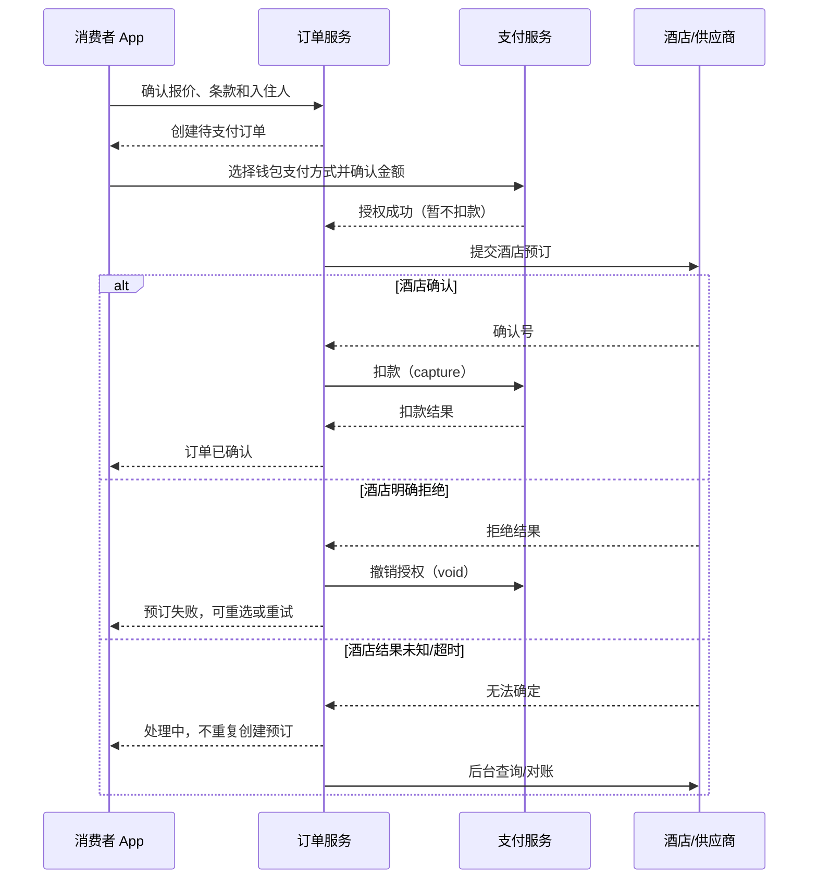

# GO 酒店交易与消费者钱包：技术资料与实现方案

> 本文面向当前 GO 工程的消费者酒店预订、钱包支付方式和开发期模拟付款。公开资料用于学习行业通用模式；工程现状以本仓库代码为准。本文描述的是代码设计与候选实现，不表示任何远程环境已部署或已经验证。

## 1. 先建立业务模型

“钱包”在酒店交易中容易被理解成可充值、提现的现金账户。但消费者侧第一阶段更适合做成**支付方式钱包**：保存经过支付服务商 token 化的引用，供结账时选择。它与平台的资金账户、酒店应收、供应商结算账户和账本不是一回事。

一笔酒店交易至少涉及以下业务对象：

| 对象 | 负责回答的问题 | 典型字段/状态 |
|---|---|---|
| 酒店报价 / 预订占位 | 房价、库存、入住规则此刻是否仍有效？ | quote、prebook、到期时间、房价规则摘要 |
| 酒店订单 | 消费者买了什么，当前履约状态是什么？ | order、金额、币种、订单状态、酒店确认号 |
| 钱包支付方式 | 消费者选择了哪个已保存的支付凭证引用？ | payment method ID、服务商 token、默认标记、状态 |
| 支付意图 / 尝试 | 为什么收款、收多少、当前授权或扣款到哪一步？ | intent、attempt、金额、币种、幂等键、支付状态 |
| 供应商履约 | 酒店是否接受预订，结果明确还是未知？ | fulfillment、供应商确认号、重试/对账状态 |
| 资金移动与账本 | 授权、扣款、撤销、退款各是多少？钱从谁流向谁？ | authorization、capture、void、refund、ledger entries |
| 对账 / 恢复 | 本地结果与支付服务商、酒店的实际结果是否一致？ | 外部引用、状态查询、差异、恢复任务 |

订单、支付、供应商履约和账本应保持独立的状态事实，再用明确的关联 ID 串起来。订单 `CONFIRMED` 不等同于资金扣款成功；支付 `AUTHORIZED` 也不代表酒店确认成功。

## 2. 酒店付款与履约的常见流程

酒店库存和价格会变化，付款通常需要协调支付渠道与酒店供应商。一个典型流程如下：

这是一个跨服务的**Saga/补偿流程**，不是单个数据库事务。支付授权成功但酒店失败时，需要撤销授权；酒店成功但扣款结果未知时，需要对账和恢复，不能因为 HTTP 超时就盲目再次预订或重复扣款。

### 2.1 付款前

1. 读取当前报价和取消/退款规则；检查报价有效期。
2. 重新确认酒店价格和库存，必要时要求消费者重新确认变价。
3. 确认入住人和最小必要个人资料授权。
4. 创建订单，服务器记录权威金额与币种。客户端金额只作为展示和防止误确认的快照，不能作为最终扣款依据。
5. 消费者选择支付方式。服务端校验该方式属于当前账号、仍有效且可使用。

### 2.2 付款及酒店确认

1. 使用服务端保存的 token 引用向支付服务商请求授权。
2. 记录支付尝试和幂等键，避免客户端重试造成重复授权。
3. 向酒店提交预订，并记录供应商操作状态。
4. 酒店明确确认后再扣款；酒店明确拒绝后撤销授权。
5. 对于超时、连接中断或状态未知的外部调用，进入待对账状态。未查清之前应阻止不安全重放。

部分酒店业务会在入住前预授权，入住期间调整授权额，离店后扣款；另一些业务则在确认预订时直接扣款。具体策略取决于供应商合同、支付方式和当地规则，不能把某一个行业流程硬编码成所有酒店的唯一规则。可参考 [Adyen 的授权调整文档](https://docs.adyen.com/online-payments/adjust-authorisation/) 和 [capture 文档](https://docs.adyen.com/online-payments/capture/)。

### 2.3 取消和退款

取消订单前先按当前取消政策生成报价，明确可退金额、手续费、币种和有效期；消费者确认后再次校验报价仍有效，再调用供应商取消，并启动退款。退款是新的资金移动事实，不应简单地把原支付记录改成“已取消”。供应商取消成功但退款失败、退款结果未知等情况应可重试和对账。

参考 [Stripe Refunds API](https://docs.stripe.com/api/refunds)。

## 3. 消费者钱包的边界

### 3.1 第一阶段：支付方式钱包

第一阶段做这些能力就足够形成可用闭环：

- 查看已保存的支付方式和当前默认方式。
- 在测试环境增加模拟支付方式；生产环境不暴露该能力。
- 设置默认方式、删除方式；删除默认方式后自动选取另一个有效方式。
- 酒店结账时显式选择支付方式，并把支付方式 ID 传给后端。
- 服务端按登录用户校验支付方式归属，只将解密后的 token 交给支付适配器，API 不回传 token。
- 展示订单最新状态；不要只根据一次支付请求的 HTTP 响应推断预订最终结果。

这不是余额钱包：暂不支持充值、提现、消费者之间转账、账户余额抵扣或酒店资金托管。酒店供应商结算和平台佣金属于后台资金结算域，应另行设计。

### 3.2 真实支付凭证与 token 化

真实卡号和 CVC 不应该通过 GO 自建表单进入业务后端。正式支付应接入支付服务商的客户端 SDK / Hosted Fields，由服务商采集凭证并返回 token 或 payment method reference；GO 保存引用及必要展示元数据。只保存 token 并不自动免除 PCI DSS 义务，实际范围取决于集成方式和服务商责任划分。参见 [PCI SSC Tokenization 指南](https://listings.pcisecuritystandards.org/documents/Tokenization_Guidelines_Info_Supplement.pdf)。

开发模拟端点只收 `scenario`，不收 PAN/CVC。仓库目前另有一个 `tokenize` API 接收卡字段，因此移动端不要调用该端点，也不要用真实银行卡测试该接口；生产级接入前应由合规 PSP SDK 替换该路径，并复核 PCI DSS 范围。

### 3.3 支付状态的可靠性

- 创建支付意图或尝试时使用稳定幂等键，并将金额、币种、订单和支付方式纳入请求指纹。
- 处理异步回调时验证签名、事件 ID 和支付对象归属；回调可能重复或乱序。
- 对外部状态未知的操作，读取支付服务商和酒店的事实后再恢复，不能用客户端再次点击来“猜”结果。
- 一个业务订单可以有多次失败尝试，但同一成功扣款不可重复记账。
- 金额使用最小货币单位整数存储；客户端不能决定实际扣款金额。

Stripe 文档可帮助理解 PaymentIntent 状态机、保存支付方式与幂等： [PaymentIntents](https://docs.stripe.com/api/payment_intents)、[SetupIntents](https://docs.stripe.com/api/setup_intents)、[React Native 保存支付方式](https://docs.stripe.com/payments/save-during-payment?platform=react-native)、[幂等请求](https://docs.stripe.com/api/idempotent_requests)。

## 4. 供应商履约、平台账本和结算

支付服务商确认收款，只说明支付渠道处理了资金，不代表平台已完成对酒店的结算。平台通常还需要单独计算：消费者实付、优惠承担方、平台佣金、酒店应收、退款/拒付、支付通道费用、结算周期和结算状态。

账本应采用不可变分录的思路：更正通过反向/调整分录表达，而不是覆盖历史金额。每个资金移动需绑定订单、支付意图、外部支付引用和业务原因。平台收款后再向酒店转账与“直接由支付服务商拆分收款”是不同资金模型，服务商能力、平台责任和地区法规也不同。Stripe 的 [Connect separate charges and transfers](https://docs.stripe.com/connect/separate-charges-and-transfers) 是其中一种平台型收款/转账模型的参考，不代表 GO 应照搬。

## 5. 可学习的公开技术资料

| 主题 | 资料 | 阅读时关注 |
|---|---|---|
| 酒店预授权和调额 | [Adyen Adjust Authorisation](https://docs.adyen.com/online-payments/adjust-authorisation/) | 预授权何时调整、何时捕获/撤销、支付方式差异 |
| 支付授权与扣款 | [Adyen Capture](https://docs.adyen.com/online-payments/capture/) | 授权与实际 capture 的时序及限制 |
| 支付生命周期 | [Stripe PaymentIntents](https://docs.stripe.com/api/payment_intents) | 一个付款对象的状态流转、成功与失败语义 |
| 保存支付凭证 | [Stripe SetupIntents](https://docs.stripe.com/api/setup_intents)、[React Native 保存方式](https://docs.stripe.com/payments/save-during-payment?platform=react-native) | 保存方式与收款的区别、用户同意、异步结果 |
| 防止重复请求 | [Stripe Idempotent Requests](https://docs.stripe.com/api/idempotent_requests) | 重试的安全语义和相同 key 的请求指纹 |
| 退款 | [Stripe Refunds](https://docs.stripe.com/api/refunds) | 退款是独立资金动作，可能异步或失败 |
| 平台与酒店结算 | [Stripe Connect separate charges and transfers](https://docs.stripe.com/connect/separate-charges-and-transfers) | 平台收费与后续向服务方转账的资金模型 |
| 跨服务事务 | [AWS Saga Patterns](https://docs.aws.amazon.com/prescriptive-guidance/latest/cloud-design-patterns/saga-patterns.html)、[Saga Orchestration](https://docs.aws.amazon.com/prescriptive-guidance/latest/cloud-design-patterns/saga-orchestration.html) | 本地事务、补偿动作、编排与恢复 |
| 支付卡数据保护 | [PCI SSC Tokenization Guidelines](https://listings.pcisecuritystandards.org/documents/Tokenization_Guidelines_Info_Supplement.pdf) | token 化的边界、敏感数据和合规责任 |

## 6. GO 工程现状与本次实现

### 6.1 现有后端能力

- `application/src/go_hotel/consumer/service.py` 已有消费者钱包与支付方式持久化逻辑；支付 token 使用加密字段保存，钱包响应只返回展示信息。
- `application/src/go_hotel/api/routes/consumer_identity.py` 暴露钱包读取、支付方式 tokenization 和删除 API。
- `application/src/go_hotel/api/routes/consumer_checkout.py` 有隔离结账入口，按环境限制模拟交易，且对服务器订单金额、币种和订单所有权进行校验。
- `application/src/go_hotel/services/booking.py` 的酒店支付链路是“支付授权 → 酒店确认 → 成功后 capture”；明确的酒店拒绝会走授权撤销补偿，未知结果进入恢复/对账路径。
- `application/src/go_hotel/payments/mock.py` 已有模拟授权成功、授权拒绝和 capture 失败结果。
- `application/src/go_hotel/db/models.py` 中 `ConsumerWalletRow` 与 `ConsumerPaymentMethodRow` 已存在，不需要新增表字段来保存模拟场景。

### 6.2 本次移动端闭环

- `application/mobile/go-app/src/screens/WalletScreen.tsx` 展示方式列表，添加三种模拟场景，允许设置默认方式和删除方式。不会在 App 里输入或传输卡号/CVC。
- `application/mobile/go-app/src/screens/CheckoutScreen.tsx` 在 HOTEL 且模拟能力开放时读取钱包、选择方式；钱包无方式时可跳转 GO Wallet。
- `application/mobile/go-app/src/domain/orderActions.ts` 付款时将支付方式 ID 一并纳入请求与幂等键指纹，发起后仍读取原订单确认状态。
- `application/src/go_hotel/api/routes/consumer_checkout.py` 对 HOTEL 要求提供方式 ID，再由后端校验当前登录人对该方式的所有权并解密 token；其他垂类不接受该字段。
- `application/src/go_hotel/api/routes/consumer_identity.py` 增加模拟方式创建和默认方式设置接口。`local`、`test`、`demo` 环境开放；`staging` 的酒店模拟能力还必须显式配置 `SIMULATED_CHECKOUT_ENABLED_IN_STAGING=true`，默认关闭。此 staging 开关只允许 HOTEL 垂类，不会开放其他垂类模拟结账，也不会把 `APP_ENV` 改成 `local`。
- staging 模拟结账另要求订单对应的供应商身份严格为 `conn_mock_hotel` / `sup_mock`；非 mock 酒店订单会被拒绝，避免模拟入口进入真实供应商履约。

### 6.3 模拟场景

| 场景 | 模拟器效果 | 预期用户观察 |
|---|---|---|
| `SUCCESS` | 授权成功；供应商确认后 capture 成功 | 酒店订单确认、支付完成 |
| `DECLINED` | 授权被拒绝 | 订单不能确认，可选择另一种模拟方式重试 |
| `CAPTURE_FAILED` | 授权成功，酒店确认后 capture 失败 | 进入支付恢复/对账语义，不应伪装为支付成功 |

这些结果只通过本地 mock payment provider 模拟，不会联系真实支付网络。staging 开启时还必须通过 mock 酒店身份校验；能力接口分别返回通用 `simulation_available` 和酒店专用 `hotel_simulation_available`。未开放时 App 隐藏模拟方式创建入口并禁用结账，不能通过前端改值绕过后端校验。**此仓库代码只定义了开关和隔离条件，不代表 staging 已开启或已部署。**

## 7. 逐步学习和后续演进建议

1. 先读本仓库 `booking.py`，沿着 `pay → confirm → capture/void` 跟踪订单状态和补偿动作。
2. 再读 `consumer_checkout.py`、`consumer_identity.py` 和 `consumer/service.py`，理解 API 边界、身份归属与 token 读取。
3. 对照 `payments/mock.py` 和数据库中的支付/订单模型，区分支付尝试与订单状态。
4. 运行消费者完整流程时，依次观察：钱包方式创建 → 创建酒店待支付订单 → 选方式 → 支付授权 → 酒店模拟确认 → capture → 重读订单。
5. 后续再独立设计真实 PSP SDK 接入、支付 webhook、酒店取消/退款、账本、供应商结算、对账后台和风控；不要把它们混成一个“钱包余额”字段。

## 8. 当前范围之外

- 没有真实银行卡绑定、真实支付、充值、提现、消费者余额、酒店托管资金或供应商结算。
- 没有新增数据库 schema；模拟方式复用既有支付方式表和加密 token 字段。
- 本文不证明远程服务器或手机上运行的后端已更新。本次仅记录架构资料并修改代码候选；需要后续单独构建/部署后才能在设备上体验。
