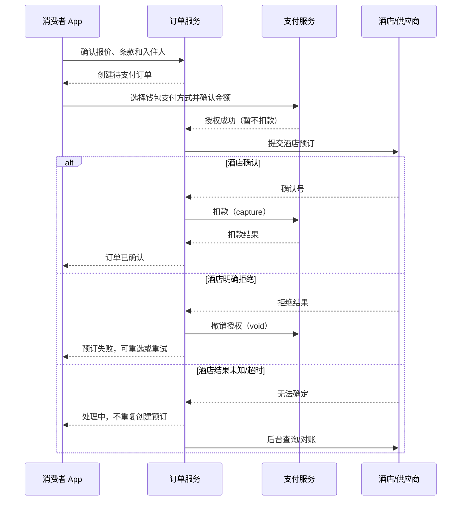

# GO 酒店交易与消费者钱包：技术资料与实现方案

> 本文面向当前 GO 工程的消费者酒店预订、钱包支付方式和开发期模拟付款。公开资料用于学习行业通用模式；工程现状以本仓库代码为准。本文描述的是代码设计与候选实现，不表示任何远程环境已部署或已经验证。

## 1. 先建立业务模型

“钱包”在酒店交易中容易被理解成可充值、提现的现金账户。但消费者侧第一阶段更适合做成**支付方式钱包**：保存经过支付服务商 token 化的引用，供结账时选择。它与平台的资金账户、酒店应收、供应商结算账户和账本不是一回事。

一笔酒店交易至少涉及以下业务对象：

| 对象 | 负责回答的问题 | 典型字段/状态 |
|---|---|---|
| 酒店报价 / 预订占位 | 房价、库存、入住规则此刻是否仍有效？ | quote、prebook、到期时间、房价规则摘要 |
| 酒店订单 | 消费者买了什么，当前履约状态是什么？ | order、金额、币种、订单状态、酒店确认号 |
| 钱包支付方式 | 消费者选择了哪个已保存的支付凭证引用？ | payment method ID、服务商 token、默认标记、状态 |
| 支付意图 / 尝试 | 为什么收款、收多少、当前授权或扣款到哪一步？ | intent、attempt、金额、币种、幂等键、支付状态 |
| 供应商履约 | 酒店是否接受预订，结果明确还是未知？ | fulfillment、供应商确认号、重试/对账状态 |
| 资金移动与账本 | 授权、扣款、撤销、退款各是多少？钱从谁流向谁？ | authorization、capture、void、refund、ledger entries |
| 对账 / 恢复 | 本地结果与支付服务商、酒店的实际结果是否一致？ | 外部引用、状态查询、差异、恢复任务 |

订单、支付、供应商履约和账本应保持独立的状态事实，再用明确的关联 ID 串起来。订单 `CONFIRMED` 不等同于资金扣款成功；支付 `AUTHORIZED` 也不代表酒店确认成功。

## 2. 酒店付款与履约的常见流程

酒店库存和价格会变化，付款通常需要协调支付渠道与酒店供应商。一个典型流程如下：



这是一个跨服务的**Saga/补偿流程**，不是单个数据库事务。支付授权成功但酒店失败时，需要撤销授权；酒店成功但扣款结果未知时，需要对账和恢复，不能因为 HTTP 超时就盲目再次预订或重复扣款。

### 2.1 付款前

1. 读取当前报价和取消/退款规则；检查报价有效期。
2. 重新确认酒店价格和库存，必要时要求消费者重新确认变价。
3. 确认入住人和最小必要个人资料授权。
4. 创建订单，服务器记录权威金额与币种。客户端金额只作为展示和防止误确认的快照，不能作为最终扣款依据。
5. 消费者选择支付方式。服务端校验该方式属于当前账号、仍有效且可使用。

### 2.2 付款及酒店确认

1. 使用服务端保存的 token 引用向支付服务商请求授权。
2. 记录支付尝试和幂等键，避免客户端重试造成重复授权。
3. 向酒店提交预订，并记录供应商操作状态。
4. 酒店明确确认后再扣款；酒店明确拒绝后撤销授权。
5. 对于超时、连接中断或状态未知的外部调用，进入待对账状态。未查清之前应阻止不安全重放。

部分酒店业务会在入住前预授权，入住期间调整授权额，离店后扣款；另一些业务则在确认预订时直接扣款。具体策略取决于供应商合同、支付方式和当地规则，不能把某一个行业流程硬编码成所有酒店的唯一规则。可参考 [Adyen 的授权调整文档](https://docs.adyen.com/online-payments/adjust-authorisation/) 和 [capture 文档](https://docs.adyen.com/online-payments/capture/)。

### 2.3 取消和退款

取消订单前先按当前取消政策生成报价，明确可退金额、手续费、币种和有效期；消费者确认后再次校验报价仍有效，再调用供应商取消，并启动退款。退款是新的资金移动事实，不应简单地把原支付记录改成“已取消”。供应商取消成功但退款失败、退款结果未知等情况应可重试和对账。

参考 [Stripe Refunds API](https://docs.stripe.com/api/refunds)。

## 3. 消费者钱包的边界

### 3.1 GO 消费者钱包

当前产品路径使用 GO 钱包现金余额支付酒店订单，不在该流程里选择支付宝、微信或银行卡支付渠道：

- 钱包页区分现金余额、返现余额和已保存银行卡数量。
- 酒店结账只扣现金余额；返现单独显示，直到明确返现的发放、解锁和使用规则后再接入计算。
- 已保存银行卡是支付凭证展示信息，不作为当前钱包支付的资金来源。
- 服务端按登录用户、订单归属和订单金额校验钱包付款，并用原子余额变更、账本流水和幂等键防止超扣、重复扣款。
- 酒店拒绝预订时退回已扣现金；酒店结果未知时保持待处理并进入恢复/对账，不根据客户端响应臆测成功。

当前实现没有充值或提现入口，钱包余额不代表真实银行存款或酒店托管资金。供应商结算和平台佣金仍属于独立的后台结算域。

### 3.2 真实支付凭证与 token 化

真实卡号和 CVC 不应该通过 GO 自建表单进入业务后端。正式支付应接入支付服务商的客户端 SDK / Hosted Fields，由服务商采集凭证并返回 token 或 payment method reference；GO 保存引用及必要展示元数据。只保存 token 并不自动免除 PCI DSS 义务，实际范围取决于集成方式和服务商责任划分。参见 [PCI SSC Tokenization 指南](https://listings.pcisecuritystandards.org/documents/Tokenization_Guidelines_Info_Supplement.pdf)。

银行卡凭证仍须由合规 PSP SDK / Hosted Fields 采集。GO 钱包的内部现金余额扣款不采集银行卡号，也不会调用外部支付网络。仓库现有 tokenization API 仍需在接入真实 PSP SDK 前完成合规改造。

### 3.3 支付状态的可靠性

- 创建支付意图或尝试时使用稳定幂等键，并将金额、币种、订单和支付方式纳入请求指纹。
- 处理异步回调时验证签名、事件 ID 和支付对象归属；回调可能重复或乱序。
- 对外部状态未知的操作，读取支付服务商和酒店的事实后再恢复，不能用客户端再次点击来“猜”结果。
- 一个业务订单可以有多次失败尝试，但同一成功扣款不可重复记账。
- 金额使用最小货币单位整数存储；客户端不能决定实际扣款金额。

Stripe 文档可帮助理解 PaymentIntent 状态机、保存支付方式与幂等： [PaymentIntents](https://docs.stripe.com/api/payment_intents)、[SetupIntents](https://docs.stripe.com/api/setup_intents)、[React Native 保存支付方式](https://docs.stripe.com/payments/save-during-payment?platform=react-native)、[幂等请求](https://docs.stripe.com/api/idempotent_requests)。

## 4. 供应商履约、平台账本和结算

支付服务商确认收款，只说明支付渠道处理了资金，不代表平台已完成对酒店的结算。平台通常还需要单独计算：消费者实付、优惠承担方、平台佣金、酒店应收、退款/拒付、支付通道费用、结算周期和结算状态。

账本应采用不可变分录的思路：更正通过反向/调整分录表达，而不是覆盖历史金额。每个资金移动需绑定订单、支付意图、外部支付引用和业务原因。平台收款后再向酒店转账与“直接由支付服务商拆分收款”是不同资金模型，服务商能力、平台责任和地区法规也不同。Stripe 的 [Connect separate charges and transfers](https://docs.stripe.com/connect/separate-charges-and-transfers) 是其中一种平台型收款/转账模型的参考，不代表 GO 应照搬。

## 5. 可学习的公开技术资料

| 主题 | 资料 | 阅读时关注 |
|---|---|---|
| 酒店预授权和调额 | [Adyen Adjust Authorisation](https://docs.adyen.com/online-payments/adjust-authorisation/) | 预授权何时调整、何时捕获/撤销、支付方式差异 |
| 支付授权与扣款 | [Adyen Capture](https://docs.adyen.com/online-payments/capture/) | 授权与实际 capture 的时序及限制 |
| 支付生命周期 | [Stripe PaymentIntents](https://docs.stripe.com/api/payment_intents) | 一个付款对象的状态流转、成功与失败语义 |
| 保存支付凭证 | [Stripe SetupIntents](https://docs.stripe.com/api/setup_intents)、[React Native 保存方式](https://docs.stripe.com/payments/save-during-payment?platform=react-native) | 保存方式与收款的区别、用户同意、异步结果 |
| 防止重复请求 | [Stripe Idempotent Requests](https://docs.stripe.com/api/idempotent_requests) | 重试的安全语义和相同 key 的请求指纹 |
| 退款 | [Stripe Refunds](https://docs.stripe.com/api/refunds) | 退款是独立资金动作，可能异步或失败 |
| 平台与酒店结算 | [Stripe Connect separate charges and transfers](https://docs.stripe.com/connect/separate-charges-and-transfers) | 平台收费与后续向服务方转账的资金模型 |
| 跨服务事务 | [AWS Saga Patterns](https://docs.aws.amazon.com/prescriptive-guidance/latest/cloud-design-patterns/saga-patterns.html)、[Saga Orchestration](https://docs.aws.amazon.com/prescriptive-guidance/latest/cloud-design-patterns/saga-orchestration.html) | 本地事务、补偿动作、编排与恢复 |
| 支付卡数据保护 | [PCI SSC Tokenization Guidelines](https://listings.pcisecuritystandards.org/documents/Tokenization_Guidelines_Info_Supplement.pdf) | token 化的边界、敏感数据和合规责任 |

## 6. GO 工程现状与酒店钱包支付实现

### 6.1 用户路径

```text
酒店详情 → 房型与报价 → 比价并选择 → Prebook 价格/库存复核
→ 核对入住人和酒店规则 → 创建待付款订单 → 钱包支付 → 酒店确认
```

“比价并选择”不会直接扣款。它先复核报价和库存，然后在后续步骤建立订单；只有用户在支付页确认钱包现金支付时才扣款。这样支付金额始终来自服务端订单，而不是客户端传来的展示价格。

### 6.2 钱包组成

- `cash_balance_minor`：可用于酒店钱包支付的现金余额，按人民币分存储。
- `cashback_balance_minor`：独立展示的返现余额。本实现不把返现折入现金余额，也不在没有明确返现规则时自动消费或发放返现。
- `payment_methods` / `bank_card_count`：仅展示已保存的银行卡张数及脱敏卡面。银行卡不会在这条酒店钱包流程中被扣款。
- `consumer_wallet_ledger`：追加式余额流水，记录酒店支付扣款与预订失败后的余额退回，并用唯一幂等键防止重复记账。

新注册钱包的现金和返现余额均从 0 开始。当前没有充值入口或返现发放规则；若现金余额不足，服务端会拒绝支付并保留订单，不会自动创建测试资金。

### 6.3 后端执行顺序

1. `POST /v1/consumer/wallet/checkout/{order_id}` 校验登录用户、订单归属、币种、服务端金额和订单状态。
2. 在同一数据库事务中锁定订单与钱包；检查余额足够后扣减现金，追加 `HOTEL_PAYMENT_DEBIT` 流水，创建 `GO_WALLET` 授权支付记录并将订单推进到 `PAYMENT_AUTHORIZED`。
3. 调用既有 `booking_service.confirm()` 完成酒店预订。酒店明确拒绝时退回已扣现金并追加 `HOTEL_PAYMENT_RELEASE`；酒店状态未知时保留待处理状态，等待原有恢复/对账流程。
4. 酒店确认后将钱包支付记录 capture 并确认订单。此步骤只结清 GO 钱包内部余额扣款，不调用支付宝、微信或银行卡支付网络。

钱包扣款接口使用 `Idempotency-Key`。相同请求重试会复用支付记录，不能再次扣款。每笔流水记录整数分金额、扣款后的余额、订单和唯一幂等键。

### 6.4 移动端

- `WalletScreen.tsx` 显示现金余额、返现余额、银行卡数量及脱敏卡片，不再提供“添加开发模拟方式”。
- `CheckoutScreen.tsx` 的 HOTEL 分支显示钱包现金余额与应付金额，并调用钱包 checkout API；其他垂类沿用各自现有能力。
- `HotelCompareScreen.tsx` 的比价选择仍先进入 Prebook 和订单核对；后续酒店付款页使用钱包现金余额。

酒店通用模拟 checkout 入口已对 HOTEL 禁止，能力接口固定返回 `hotel_simulation_available=false`。真实 PSP、充值、提现、返现核算仍未实现。

## 7. 逐步学习和后续演进建议

1. 读 `consumer_checkout.py` 与 `consumer/service.py`，理解余额检查、幂等键和钱包流水。
2. 读 `booking.py`，跟踪钱包授权如何复用酒店确认 Saga，以及供应商拒绝和未知结果的处理方式。
3. 读 `models.py` 与 Alembic migration `0136_consumer_wallet_cash_ledger.py`，检查钱包余额和流水表结构。
4. 完整验收时，从房型选择开始，确认订单金额后用已有现金余额付款；再检查订单状态、钱包余额变化和 ledger entry。
5. 后续再分别设计充值、返现规则、退款回钱包、真实 PSP 接入和银行卡管理，不要把它们混成一项“模拟支付”。

## 8. 当前范围之外

- 没有银行卡扣款、充值、提现或返现发放规则；已保存银行卡仅作卡片信息展示。
- 钱包现金余额与支付流水已加入候选 schema；余额资金来源和充值业务尚未实现。
- 本文描述的是当前工作区代码候选，不表示 APK 已重建、数据库 migration 已运行或远程服务已更新。
